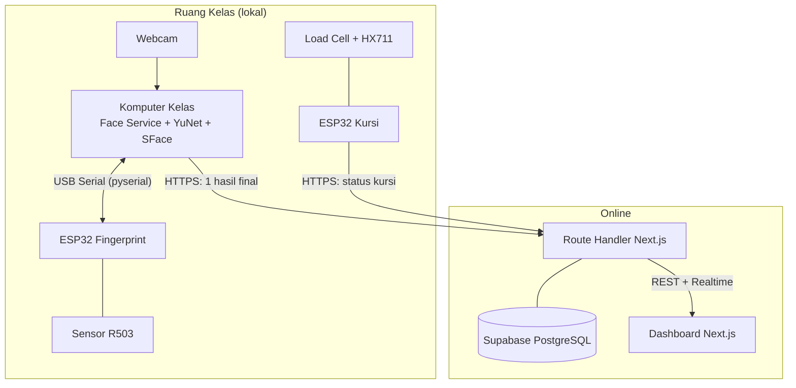
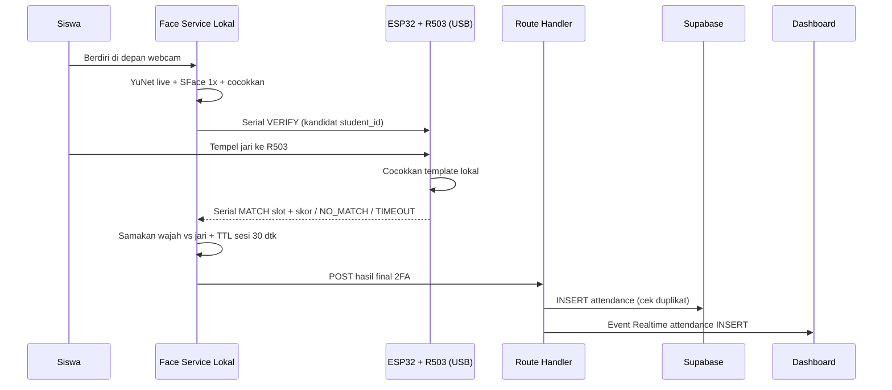

# Arsitektur Sistem

> **Aktif (2026-10-20)** — topologi utama: ESP32 Fingerprint via **USB Serial** ke komputer kelas. Face service lokal memutus 2FA (wajah + jari), cloud terima 1 hasil final. Versi lama (Wi-Fi polling via cloud) diarsipkan di [`archive/wifi-polling/`](archive/wifi-polling/) sebagai fallback bila kabel USB tidak sampai di lokasi.

## Tujuan

Dokumen ini menjelaskan arsitektur keseluruhan Smart Classroom Attendance: komponen apa saja yang ada, tanggung jawab masing-masing, bagaimana mereka berkomunikasi, serta alur normal dan kondisi kegagalan.

Dokumen terkait: [face-recognition.md](face-recognition.md), [fingerprint.md](fingerprint.md), [iot-monitoring.md](iot-monitoring.md), [backend.md](backend.md), [database.md](database.md), [dashboard.md](dashboard.md), [communication-flow.md](communication-flow.md). Kembali ke [README](../../README.md).

## Topologi Fisik

```
Laptop kelas --USB/COM--> ESP32 --UART--> sensor R503   (fingerprint, daya dari USB)
Laptop kelas --webcam--> face service lokal              (YuNet + SFace)
ESP32 kursi --Wi-Fi--> Route Handler Next.js             (HX711, tiap bangku)
Laptop kelas --HTTPS--> Route Handler Next.js + Supabase (1 hasil final per absensi)
```

## Komponen dan Tanggung Jawab

| Komponen | Lokasi | Teknologi | Tanggung jawab |
|---|---|---|---|
| Komputer kelas + webcam | Lokal (ruang kelas) | Webcam, Python 3.10+, OpenCV | Menangkap frame, menjalankan face service |
| Face service lokal | Lokal (komputer kelas) | FastAPI (`apps/face-service/`) | Deteksi (YuNet), embedding (SFace), pencocokan, perintah fingerprint via USB Serial, kirim hasil final ke cloud |
| ESP32 Fingerprint | Lokal (meja kelas, kabel USB ke laptop) | ESP32 + sensor R503 | Terima perintah serial, kendalikan R503 (enroll/verify), kembalikan ID template + skor via serial |
| ESP32 Kursi | Lokal (bawah bangku) | ESP32 + load cell + HX711 | Baca beban via Wi-Fi POST berkala ke Route Handler |
| Backend cloud | Online | Next.js Route Handlers + Supabase | Terima hasil final, cek aturan (jadwal/duplikat), simpan, Auth + Realtime ke dashboard |
| Database | Online | Supabase PostgreSQL | Siswa, perangkat, absensi, status kursi |
| Dashboard | Online / browser | Next.js + React | Visualisasi kehadiran, kursi, riwayat, rekap |

## Batas Tanggung Jawab Service

Prinsip utama yang **MUST** dipatuhi:

- **Face service lokal** memutus **seluruh 2FA** (wajah cocok + jari cocok = absen valid). Ia mengirim 1 hasil final ke cloud, bukan kandidat mentah.
- **Route Handler Next.js** memvalidasi hasil final (jadwal, kelas, duplikat via constraint unik) lalu menyimpan. Ia bukan perantara perintah fingerprint.
- **ESP32 Fingerprint** tidak menyimpan logika absensi — hanya driver R503 via perintah serial.
- **ESP32 Kursi** independen via Wi-Fi; kursinya telemetri, bukan bukti absensi.
- **Dashboard** read-mostly: tampilkan data backend, tidak menulis absensi langsung.

## Hubungan Antarkomponen

- Face service ↔ ESP32 Fingerprint: **USB Serial** (`pyserial`, COM port, 115200 baud). Face service selalu inisiator (`VERIFY:<student_id>`, `ENROLL:<student_id>:<slot>`); ESP32 menjawab (`MATCH:<slot>:<score>`, `NO_MATCH`, `TIMEOUT`, `ERROR:<sebab>`).
- Face service → Route Handler: **HTTPS POST** 1 hasil final per absensi (outbound, tanpa port forwarding).
- ESP32 Kursi → Route Handler: **HTTPS POST** status berkala (Wi-Fi sekolah, outbound).
- Route Handler ↔ Supabase: koneksi internal + Realtime (`postgres_changes`) ke dashboard.
- Face service **MUST NOT** diekspos ke internet; hanya localhost/LAN kelas + port serial lokal.

## Diagram Arsitektur



## Diagram Urutan (Alur Absensi Normal)



## Alur Normal

1. Face service mengunci kandidat wajah (SFace 1x, anti-stale: IoU + TTL).
2. Face service mengirim `VERIFY` via USB Serial; R503 menyala, siswa menempelkan jari.
3. ESP32 mengembalikan `MATCH`/`NO_MATCH`/`TIMEOUT` via serial dalam milidetik.
4. Face service menyamakan identitas wajah vs slot fingerprint + cek TTL sesi.
5. Face service POST 1 hasil final ke Route Handler; cloud cek jadwal/duplikat, simpan.
6. Dashboard menerima event Realtime dan memperbarui tampilan.

## Kondisi Kegagalan

| Kondisi | Penanganan |
|---|---|
| Wajah tidak dikenal / di bawah threshold | Tidak ada perintah serial; tidak ada absensi. Lihat [face-recognition.md](face-recognition.md). |
| Banyak wajah dalam frame | Wajah terbesar diproses; antrean satu orang. |
| Fingerprint tidak cocok / timeout | ESP32 lapor via serial; sesi lokal dibatalkan. Lihat [fingerprint.md](fingerprint.md). |
| Identitas wajah ≠ identitas fingerprint | Absensi ditolak; dicatat untuk audit. |
| Absensi duplikat | Ditolak constraint unik DB + cek aplikasi. Lihat [database.md](database.md). |
| Kabel USB lepas / COM port hilang | Face service tandai perangkat `offline` lokal; sesi dibatalkan; operator colok ulang → auto-reconnect. |
| Internet sekolah terputus | Hasil final di-buffer lokal terbatas, kirim ulang saat pulih; absensi saat putus tidak real-time. |
| Backend / database down | Face service retry dengan backoff; dashboard banner error. |
| Sensor kursi tidak stabil / terputus | Status `unknown`; tidak memengaruhi absensi. Lihat [iot-monitoring.md](iot-monitoring.md). |

## Kebutuhan Konektivitas

- Face service → cloud dan ESP32-Kursi → cloud: **HTTPS keluar** saja. **MUST NOT** butuh port forwarding / IP publik / ubah router.
- Face service ↔ ESP32-FP: **kabel USB** (daya + data, tanpa jaringan sama sekali).
- Identitas perangkat cloud memakai device ID + kredensial, bukan IP lokal (detail di [communication-flow.md](communication-flow.md)).

## Fallback: Topologi Wi-Fi Polling (Arsip)

Bila di lokasi ternyata kabel USB tidak sampai (jarak meja–laptop > 2 m, port kurang, dsb.), gunakan topologi cadangan: ESP32 Fingerprint via Wi-Fi polling ke cloud (`device_commands` + `command_id`). Seluruh dokumen versi itu tersimpan utuh di [`archive/wifi-polling/`](archive/wifi-polling/) (`architecture.md`, `backend.md`, `communication-flow.md`, `fingerprint.md`, `database.md`). Beralih ke fallback berarti mengembalikan 5 file tersebut + kolom `device_commands` — lihat catatan migrasi di daily `2026-10-20` §5.

## Catatan Implementasi

- Target awal: prototipe ~100 siswa, pemrosesan wajah + 2FA berbasis CPU lokal.
- Face service terverifikasi sebagian (`apps/face-service/`, FastAPI `/health` + `/recognize` + `/enroll`). Modul serial (`fingerprint_serial.py`) + firmware ESP32 dibuat saat hardware tersedia.
- Seluruh endpoint cloud, skema JSON, dan ambang batas berstatus **Rancangan** hingga implementasi diverifikasi.
