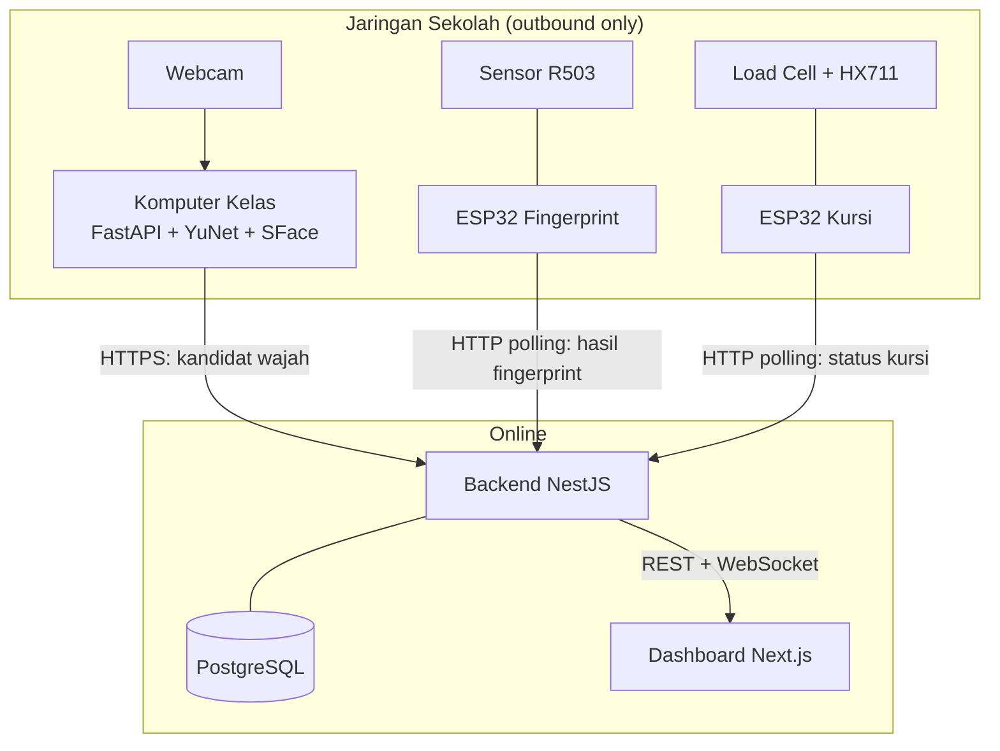
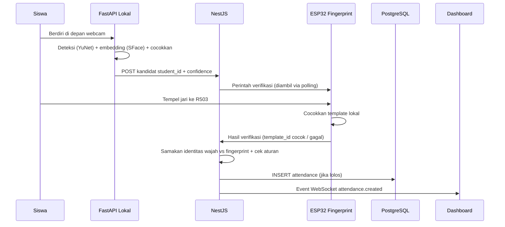

# Arsitektur Sistem

> **Rancangan** — menggambarkan arsitektur yang direncanakan. Belum ada implementasi yang diverifikasi di repository ini.

## Tujuan

Dokumen ini menjelaskan arsitektur keseluruhan Smart Classroom Attendance: komponen apa saja yang ada, tanggung jawab masing-masing, bagaimana mereka berkomunikasi, serta alur normal dan kondisi kegagalan.

Dokumen terkait: [face-recognition.md](face-recognition.md), [fingerprint.md](fingerprint.md), [iot-monitoring.md](iot-monitoring.md), [backend.md](backend.md), [database.md](database.md), [dashboard.md](dashboard.md), [communication-flow.md](communication-flow.md). Kembali ke [README](../../README.md).

## Komponen dan Tanggung Jawab

| Komponen | Lokasi | Teknologi | Tanggung jawab |
|---|---|---|---|
| Komputer kelas + webcam | Lokal (ruang kelas) | Webcam, Python 3.11, OpenCV | Menangkap frame, menjalankan service pengenalan wajah |
| Service pengenalan wajah | Lokal (komputer kelas) | FastAPI | Deteksi wajah (YuNet), ekstraksi embedding (SFace), pencocokan, pengiriman kandidat ID ke backend |
| Backend pusat | Online | NestJS | Validasi identitas ganda, pengaturan verifikasi fingerprint, validasi aturan absensi, penyimpanan transaksi, autentikasi perangkat, WebSocket ke dashboard |
| Perangkat fingerprint | Lokal (ruang kelas) | ESP32 + sensor R503 | Enrollment template, pencocokan sidik jari lokal, pelaporan hasil ke backend |
| Perangkat monitoring kursi | Lokal (ruang kelas) | ESP32 + load cell + HX711 | Pembacaan beban, kalibrasi, penentuan status kursi, pelaporan berkala |
| Database | Online (bersama backend) | PostgreSQL | Penyimpanan data siswa, perangkat, absensi, status kursi |
| Dashboard | Online / diakses browser | Next.js + React | Visualisasi kehadiran, status kursi, riwayat, rekap |

Satu ESP32 dapat berperan ganda (fingerprint + kursi) atau dipisah menjadi dua perangkat — `TBD`, tergantung implementasi firmware. Dokumentasi ini memakai istilah "ESP32 fingerprint" dan "ESP32 kursi" untuk kejelasan peran.

## Batas Tanggung Jawab Service

Prinsip utama yang **MUST** dipatuhi:

- **FastAPI lokal** bertanggung jawab atas **seluruh pemrosesan wajah** (deteksi, embedding, pencocokan, threshold). Ia tidak memutuskan absensi.
- **NestJS** adalah satu-satunya pihak yang **memutuskan dan mencatat absensi**. Ia memvalidasi kandidat wajah, mengoordinasikan verifikasi fingerprint, memeriksa aturan (jadwal, kelas, duplikat), lalu menyimpan transaksi.
- **ESP32** tidak menyimpan logika absensi. Ia hanya melakukan pencocokan biometrik lokal (fingerprint) atau pembacaan sensor (kursi) dan melaporkan hasilnya.
- **Dashboard** bersifat read-mostly: menampilkan data dari backend, tidak menulis absensi langsung.

## Hubungan Antarkomponen

- Komputer kelas (FastAPI) → NestJS: HTTPS REST API, arah keluar (outbound) dari jaringan sekolah.
- ESP32 → NestJS dan NestJS → ESP32: HTTP polling sebagai rancangan awal; ESP32 selalu memulai permintaan (lihat [communication-flow.md](communication-flow.md)).
- NestJS ↔ PostgreSQL: koneksi database internal (bukan melalui internet publik).
- NestJS → Dashboard: REST API untuk data awal + WebSocket untuk pembaruan real-time.
- Tidak ada komunikasi langsung antara FastAPI lokal dan ESP32; semua koordinasi melalui NestJS.

## Diagram Arsitektur

## Diagram Urutan (Alur Absensi Normal)

## Alur Normal

1. FastAPI mengenali wajah dan mengirim kandidat ke NestJS.
2. NestJS menandai sesi verifikasi "menunggu fingerprint" untuk kandidat tersebut.
3. ESP32 fingerprint mengambil perintah tersebut saat polling, meminta siswa menempelkan jari.
4. Hasil pencocokan dikirim kembali ke NestJS.
5. NestJS mencocokkan identitas, memeriksa jadwal/kelas/duplikat, menyimpan absensi.
6. Dashboard menerima event dan memperbarui tampilan.

## Kondisi Kegagalan

| Kondisi | Penanganan (rancangan) |
|---|---|
| Wajah tidak dikenal / confidence di bawah threshold | FastAPI tidak mengirim kandidat; tidak ada absensi. Lihat [face-recognition.md](face-recognition.md). |
| Banyak wajah dalam frame | FastAPI menolak frame atau memilih wajah terbesar — `TBD`; tidak ada absensi otomatis. |
| Fingerprint tidak cocok / timeout | ESP32 melaporkan gagal; NestJS membatalkan sesi verifikasi. Lihat [fingerprint.md](fingerprint.md). |
| Identitas wajah ≠ identitas fingerprint | Absensi ditolak; kejadian dicatat untuk audit — `TBD`. |
| Absensi duplikat (siswa sudah tercatat hari itu) | Ditolak oleh constraint database + pengecekan aplikasi. Lihat [database.md](database.md). |
| Internet sekolah terputus | FastAPI/ESP32 melakukan retry dengan backoff; sesi kedaluwarsa — `TBD`. Tidak ada mode offline penuh. |
| Backend / database down | Perangkat melakukan retry; dashboard menampilkan status error. |
| Sensor kursi tidak stabil / terputus | Status kursi ditandai `unknown`; tidak memengaruhi absensi. Lihat [iot-monitoring.md](iot-monitoring.md). |

## Kebutuhan Konektivitas Jaringan

- Backend berjalan online dengan alamat HTTPS publik.
- Komputer kelas dan ESP32 hanya membutuhkan **koneksi internet keluar** (HTTPS/HTTP). Sistem **MUST NOT** mengharuskan port forwarding, IP publik sekolah, atau perubahan konfigurasi router/Wi-Fi.
- Identitas perangkat memakai device ID + kredensial, bukan alamat IP lokal (detail di [communication-flow.md](communication-flow.md)).
- Estimasi kebutuhan bandwidth rendah (payload JSON kecil + polling berkala); angka pasti `TBD` setelah pengujian.

## Catatan Implementasi

- Target awal: prototipe ~100 siswa, pemrosesan wajah berbasis CPU.
- HTTP polling dipilih sebagai rancangan awal komunikasi backend–ESP32 karena sederhana dan lolos NAT/firewall sekolah. Migrasi ke MQTT/WebSocket `TBD` bila dibutuhkan (lihat [communication-flow.md](communication-flow.md)).
- Seluruh endpoint, skema JSON, dan ambang batas di dokumen ini berstatus **Rancangan** hingga implementasi diverifikasi.
