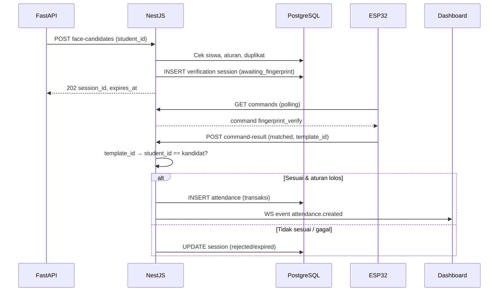

# Backend Pusat — NestJS

> **Rancangan** — semua endpoint di bawah adalah rancangan konseptual. Belum ada implementasi yang diverifikasi.

## Tanggung Jawab dan Batas Integrasi

NestJS adalah **satu-satunya otak keputusan** sistem:

- Menerima kandidat identitas wajah dari FastAPI lokal.
- Mengatur perintah verifikasi fingerprint ke/dari ESP32.
- Memvalidasi kecocokan identitas wajah vs fingerprint.
- Memvalidasi jadwal, kelas, dan aturan absensi.
- Menyimpan transaksi absensi secara konsisten ke PostgreSQL.
- Mengautentikasi perangkat dan melayani dashboard (REST + WebSocket).

**Batas:** NestJS tidak melakukan pemrosesan citra (itu tugas FastAPI), tidak membaca sensor langsung (itu tugas ESP32), dan tidak menentukan tampilan (itu tugas dashboard).

Dokumen terkait: [architecture.md](architecture.md), [face-recognition.md](face-recognition.md), [fingerprint.md](fingerprint.md), [database.md](database.md), [communication-flow.md](communication-flow.md).

## Validasi Kandidat dari FastAPI

Saat menerima kandidat wajah, backend (rancangan):

1. Memverifikasi autentikasi perangkat (device ID + kredensial).
2. Memvalidasi struktur payload dan nilai confidence.
3. Memeriksa `student_id` ada di database dan terdaftar di kelas yang relevan.
4. Memeriksa siswa belum tercatat absen (idempotensi).
5. Jika lolos → membuat **sesi verifikasi** berstatus `awaiting_fingerprint` dengan batas waktu `TBD`.

## Pengaturan Perintah dan Hasil ESP32

- Backend menyimpan antrian perintah per perangkat; ESP32 mengambilnya lewat polling (rancangan awal, detail di [communication-flow.md](communication-flow.md)).
- Setiap perintah memiliki `command_id` unik untuk idempotensi hasil.
- Hasil dari ESP32 (matched / no_match / timeout / sensor_error) diterima backend, dicocokkan ke `command_id`, dan sesi verifikasi diperbarui.
- Perintah yang tidak dijawab sampai batas waktu ditandai kedaluwarsa.

## Validasi Identitas Ganda

Aturan inti: **identitas dari template fingerprint harus sama dengan kandidat wajah** pada sesi verifikasi yang sama.

- `template_id → student_id` (dari pemetaan di database) == `student_id` kandidat wajah → lanjut.
- Berbeda / tidak cocok / timeout → sesi ditolak; kejadian dicatat untuk audit `TBD`.

## Validasi Jadwal, Kelas, dan Aturan Absensi

Rancangan aturan (nilai pasti `TBD`):

1. Waktu absen berada dalam jadwal pelajaran/kelas yang sedang berjalan.
2. Siswa terdaftar (enrolled) di kelas tersebut.
3. Jendela waktu absensi (mis. X menit sebelum–Y menit setelah jam mulai).
4. Belum ada absensi sah siswa pada sesi/pelajaran yang sama.
5. Keterlambatan dapat ditandai (status `late`) — `TBD`.

## Penyimpanan Transaksi Absensi

- Insert ke tabel `Attendance` dalam satu transaksi database.
- Pencegahan duplikat: constraint unik (siswa, sesi/kelas, tanggal) + pengecekan aplikasi — detail di [database.md](database.md).
- Setelah tersimpan, backend menyiarkan event WebSocket `attendance.created` ke dashboard.

## Autentikasi Perangkat, Otorisasi, dan HTTPS

- Semua komunikasi perangkat→backend memakai HTTPS; perangkat mengenali diri dengan `device_id` + kredensial (token/perangkat rahasia), bukan IP lokal.
- Kredensial perangkat disimpan di firmware secara aman sebatas kemampuan ESP32 dan di backend dalam bentuk hash.
- Endpoint terbagi per peran: perangkat (FastAPI & ESP32) hanya boleh memanggil endpoint perangkat; dashboard memakai autentikasi pengguna — skema detail `TBD`.
- FastAPI lokal diperlakukan sebagai "perangkat" kelas dengan kredensialnya sendiri.

## Endpoint Konseptual

> **Rancangan — Belum diimplementasikan.** Nama path pasti `TBD`.

| Grup | Method & Path (rancangan) | Fungsi |
|---|---|---|
| Face candidate | `POST /api/v1/face-candidates` | Menerima kandidat dari FastAPI |
| Device commands | `GET /api/v1/devices/{device_id}/commands` | ESP32 mengambil perintah (polling) |
| Device results | `POST /api/v1/devices/{device_id}/command-results` | ESP32 melaporkan hasil |
| Seat status | `POST /api/v1/devices/{device_id}/seat-status` | ESP32 kursi melaporkan status |
| Attendance | `GET /api/v1/attendance` | Daftar absensi (dashboard) |
| Attendance | `POST /api/v1/attendance/manual` | Koreksi manual oleh operator — `TBD` |
| Enrollment | `POST /api/v1/enrollments/fingerprint` | Memulai enrollment template |
| WebSocket | `ws://…/events` | Event real-time ke dashboard |

### Contoh `POST /api/v1/face-candidates` → `202 Accepted`

```json
{
  "session_id": "ver-20261016-0091",
  "status": "awaiting_fingerprint",
  "expires_at": "2026-10-16T07:02:00+07:00"
}
```

### Contoh `GET .../commands` → `200 OK`

```json
{
  "commands": [
    {
      "command_id": "cmd-9f31",
      "type": "fingerprint_verify",
      "student_id": "S-2026-0042",
      "created_at": "2026-10-16T07:01:25+07:00"
    }
  ]
}
```

## Diagram Sequence Proses Absensi



## Idempotensi, Retry, dan Penanganan Kegagalan

| Aspek | Rancangan |
|---|---|
| Kandidat wajah terkirim ganda (retry FastAPI) | Backend menerima ulang; jika sesi masih `awaiting_fingerprint`, perbarui saja — tidak membuat sesi baru duplikat |
| Hasil ESP32 terkirim ganda | Deduplikasi berdasar `command_id` |
| Absensi duplikat | Ditolak constraint unik DB + cek aplikasi |
| Retry perangkat | Exponential backoff dengan jitter; `TBD` interval awal |
| Sesi kedaluwarsa | Sesi `awaiting_fingerprint` melewati `expires_at` ditandai `expired` |
| Internet terputus | Perangkat menyimpan hasil terakhir sementara (buffer terbatas) dan kirim ulang saat online — `TBD` |
| Layanan backend down | Perangkat retry; dashboard menampilkan banner error |

## Integrasi WebSocket dengan Dashboard

- Backend menyiarkan event: `attendance.created`, `attendance.updated`, `seat.status_changed`, `device.offline` — daftar final `TBD`.
- Dashboard berlangganan channel berdasar kelas/hak akses pengguna.
- Format pesan: JSON dengan `type`, `payload`, `timestamp` (contoh di [dashboard.md](dashboard.md)).
- Reconnect otomatis di sisi klien; data yang terlewat saat putus diambil ulang via REST.
