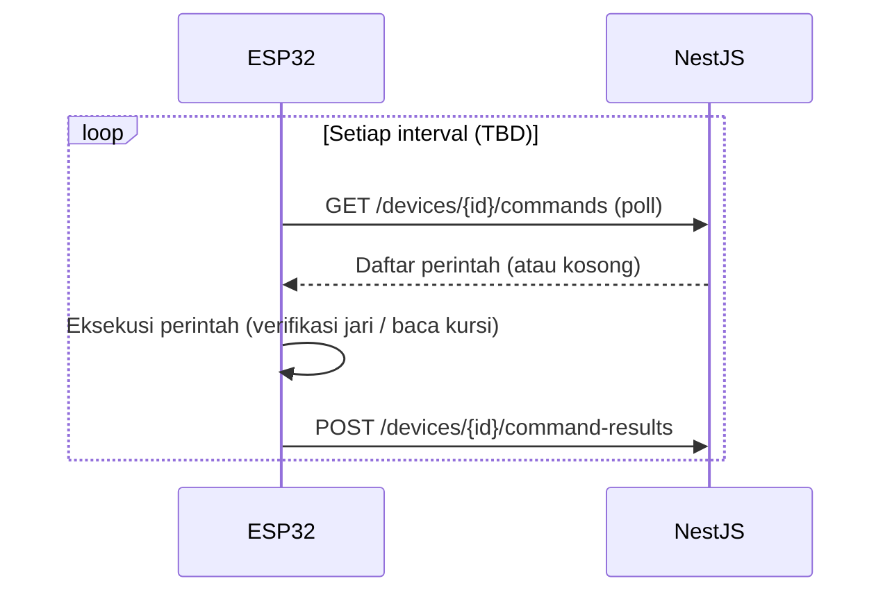
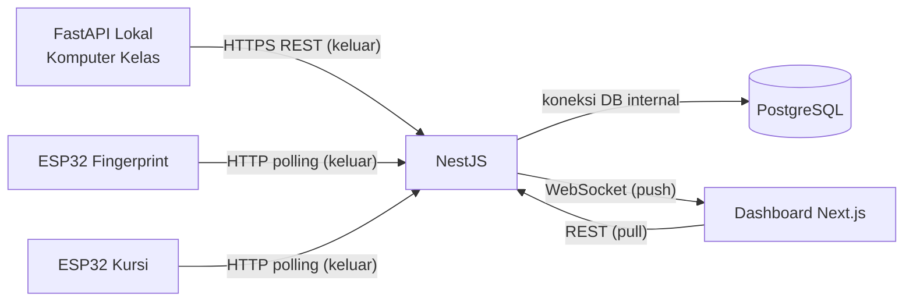

# Communication Flow — Komunikasi Antarkomponen

> **Rancangan** — rute, autentikasi, dan parameter retry belum diimplementasikan.

## Prinsip Dasar

1. Backend NestJS berjalan **online** dengan endpoint HTTPS publik.
2. Semua komponen di jaringan sekolah (komputer kelas, ESP32) **hanya memulai koneksi keluar** — tanpa port forwarding, tanpa perubahan router/Wi-Fi.
3. Identitas perangkat memakai **device ID + kredensial**, bukan alamat IP lokal (IP lokal dapat berubah dan tidak aman sebagai identitas).
4. Yang memulai permintaan menentukan arah data — lihat diagram di bawah.

## Pola Komunikasi per Rute

| Rute | Protokol | Pemulai | Catatan |
|---|---|---|---|
| FastAPI → NestJS | HTTPS REST | FastAPI | Kirim kandidat wajah; retry saat gagal |
| ESP32 → NestJS | HTTP(S) polling | ESP32 | Ambil perintah + laporkan hasil secara berkala |
| NestJS → PostgreSQL | Koneksi DB internal | NestJS | Bukan lewat internet publik |
| NestJS → Dashboard | REST + WebSocket | Dashboard (REST) / NestJS (push WS) | Data awal via REST, update via WS |
| FastAPI ↔ ESP32 | — | — | **Tidak berkomunikasi langsung**; semua via NestJS |

### FastAPI Lokal → NestJS Online

- FastAPI memanggil `POST /api/v1/face-candidates` (rancangan) via HTTPS dengan autentikasi perangkat.
- Respons `202` berisi `session_id` dan batas waktu; respons lain berarti kandidat ditolak/duplikat.
- Retry: exponential backoff + jitter; buffer hasil terbatas saat internet putus — `TBD`.

### NestJS ↔ ESP32 (HTTP Polling)

Rancangan awal memilih **HTTP polling** karena sederhana, NAT/firewall-friendly (ESP32 selalu klien), dan cukup untuk skala ~100 siswa:

- Interval polling `TBD` (trade-off: responsivitas vs beban server vs baterai/kuota).
- Alternatif masa depan: MQTT atau WebSocket perangkat — `TBD`, tidak bagian dari rancangan awal.

### NestJS ↔ PostgreSQL

Koneksi database dari backend (connection pooling). Tidak diekspos ke internet; akses hanya dari backend.

### NestJS → Dashboard Next.js

- REST untuk data awal dan riwayat (dashboard memulai).
- WebSocket untuk push real-time: backend mengirim event saat absensi tersimpan atau status kursi berubah (detail di [dashboard.md](dashboard.md)).

## Autentikasi Perangkat

- Setiap perangkat punya `device_id` unik + kredensial rahasia yang didaftarkan di backend (lihat [database.md](database.md)).
- Kredensial dikirim pada setiap permintaan (header/token — skema pasti `TBD`); backend memverifikasi sebelum memproses.
- Perangkat tanpa kredensial valid ditolak; percobaan berulang dicatat — rate limiting `TBD`.
- Alamat IP lokal **tidak** dipakai sebagai identitas atau pembeda perangkat.

## Diagram Arah Komunikasi

Semua panah keluar dari jaringan sekolah adalah **koneksi yang dimulai perangkat kelas** — tidak ada koneksi masuk yang diinisiasi dari internet ke jaringan sekolah.

## Retry, Timeout, dan Internet Terputus

| Skenario | Penanganan (rancangan) |
|---|---|
| Permintaan FastAPI gagal/timeout | Retry dengan exponential backoff + jitter; batas percobaan `TBD`; hasil disimpan sementara |
| ESP32 gagal polling | Coba interval berikutnya; beri tanda offline ke backend setelah `TBD` kali gagal berturut |
| Sesi verifikasi kedaluwarsa | Backend menandai `expired`; perintah di antrian dibatalkan |
| Internet sekolah putus total | Perangkat menyimpan hasil terbatas (buffer `TBD`) dan kirim ulang saat pulih; absensi saat putus tidak real-time |
| Backend down | Perangkat retry; dashboard menampilkan banner error dan indikator koneksi WebSocket putus |
| WebSocket dashboard putus | Reconnect otomatis; ambil ulang data via REST agar tidak ada event yang terlewat |
| Kredensial tidak valid / dicurigai | Tolak permintaan; tandai perangkat untuk ditinjau — prosedur rotasi kredensial `TBD` |

## Catatan Implementasi

- HTTP polling adalah **pilihan awal**, bukan keputusan permanen; migrasi ke mekanisme push perangkat dapat dipertimbangkan dengan alasan teknis jelas.
- Semua komunikasi luar memakai HTTPS/TLS; sertifikat dan domain backend `TBD`.
- Ukuran payload dibuat kecil (JSON ringkas) agar polling murah.
