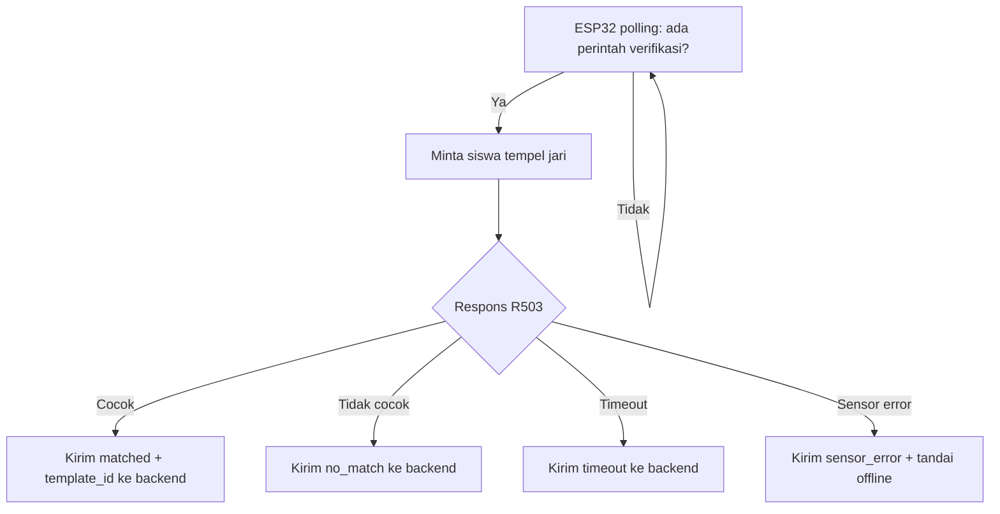
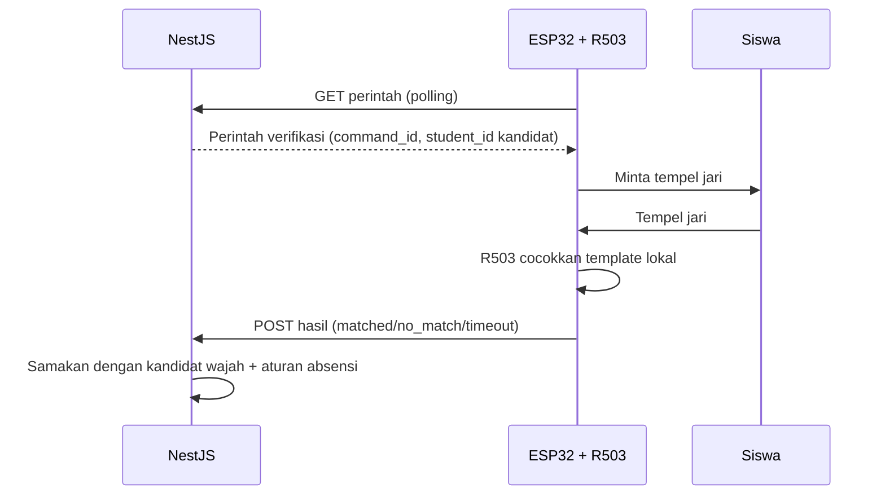

# Fingerprint — Verifikasi Sidik Jari (ESP32 + R503)

> **Rancangan** — detail perintah polling, format payload, dan timeout adalah rancangan awal. Belum ada firmware yang diverifikasi.

## Tujuan

Sensor fingerprint R503 pada ESP32 berfungsi sebagai **faktor verifikasi kedua**: memastikan siswa yang dikenali wajahnya adalah orang yang sama yang menempelkan jari. Tanpa kecocokan ini, absensi tidak dicatat.

Dokumen terkait: [architecture.md](architecture.md), [backend.md](backend.md), [communication-flow.md](communication-flow.md).

## Teknologi

| Komponen | Fungsi |
|---|---|
| ESP32 | Mikrokontroler: polling perintah ke backend, mengendalikan sensor R503, melaporkan hasil |
| Sensor fingerprint R503 | Menyimpan template sidik jari, melakukan pencocokan 1:N secara lokal, mengembalikan ID template yang cocok |

**Batasan penting:** R503 melakukan pencocokan **di dalam sensor** dan hanya mengembalikan ID template + skor, bukan citra sidik jari. Dokumentasi ini tidak mengasumsikan pengiriman citra ke server.

## Aturan Pemetaan Identitas

Aturan yang **MUST** dipatuhi: setiap ID template fingerprint di sensor harus dipetakan ke tepat satu `student_id` di backend. Tabel pemetaan disimpan di PostgreSQL (lihat [database.md](database.md)), bukan hanya di memori ESP32, agar penggantian perangkat tidak menghilangkan relasi.

## Proses Enrollment Template

1. Operator memulai enrollment dari backend/dashboard untuk `student_id` tertentu — endpoint pasti `TBD`.
2. Backend membuat perintah enrollment yang diambil ESP32 saat polling.
3. Siswa menempelkan jari 1–2 kali sesuai prosedur R503 hingga template terbentuk di sensor.
4. ESP32 melaporkan ID template yang terbentuk ke backend.
5. Backend menyimpan relasi `student_id ↔ template_id`.
6. Penghapusan siswa harus menghapus relasi dan template di sensor — prosedur pasti `TBD`.

## Alur Pencocokan Sidik Jari (Mode Absensi)

1. ESP32 mengambil perintah verifikasi dari backend (hasil identifikasi wajah sebelumnya).
2. ESP32 meminta siswa menempelkan jari (indikator LED/buzzer — `TBD`).
3. R503 mencocokkan sidik jari dengan template tersimpan secara lokal.
4. ESP32 mengirim hasil ke backend: ID template yang cocok + skor, atau status gagal/timeout.
5. Backend membandingkan `student_id` dari template dengan kandidat wajah; sama → lanjut ke validasi aturan absensi.

Contoh payload hasil (konseptual, `TBD`):

```json
{
  "device_id": "esp32-fp-01",
  "command_id": "cmd-9f31",
  "result": "matched",
  "template_id": 42,
  "score": 180,
  "verified_at": "2026-10-16T07:02:05+07:00"
}
```

Contoh hasil gagal:

```json
{
  "device_id": "esp32-fp-01",
  "command_id": "cmd-9f31",
  "result": "no_match",
  "template_id": null,
  "verified_at": "2026-10-16T07:02:40+07:00"
}
```

## Penanganan Template Tidak Cocok, Timeout, dan Offline

| Kondisi | Penanganan (rancangan) |
|---|---|
| Template tidak cocok | Laporkan `no_match`; backend membatalkan sesi; siswa dapat mencoba ulang — batas percobaan `TBD` |
| Timeout (siswa tidak menempelkan jari) | ESP32 melaporkan `timeout` setelah `TBD` detik; sesi kedaluwarsa |
| Template ID tidak terpetakan ke siswa | Backend menolak; tandai untuk audit; perbaiki data enrollment |
| ESP32 offline | Perintah menumpuk hingga kedaluwarsa; absensi tidak dapat dilengkapi; retry dengan backoff saat online kembali |
| Sensor terputus / error hardware | ESP32 melaporkan status kesehatan `sensor_error`; dashboard menandai perangkat bermasalah — format `TBD` |

## Diagram Flowchart



## Sequence Diagram



## Keamanan dan Batasan Verifikasi Biometrik

- Template sidik jari tidak pernah keluar dari sensor sebagai citra; yang transit hanya ID + hasil pencocokan melalui HTTPS/polling terautentikasi.
- ESP32 memakai device ID + kredensial (bukan IP lokal) — detail di [communication-flow.md](communication-flow.md).
- Sidik jari bukan identitas mutlak: sensor dapat menolak jari basah/kotor dan (dengan probabilitas kecil) salah menerima. Karena itu sistem memakai **dua faktor** (wajah + jari), bukan satu.
- Akses enrollment dibatasi untuk operator terautentikasi; enrollment mandiri oleh siswa tanpa pengawasan `TBD` (rancangan: tidak diizinkan).
- Penghapusan data siswa harus mencakup relasi template; penyimpanan template cadangan di luar sensor `TBD` (rancangan: tidak ada).
