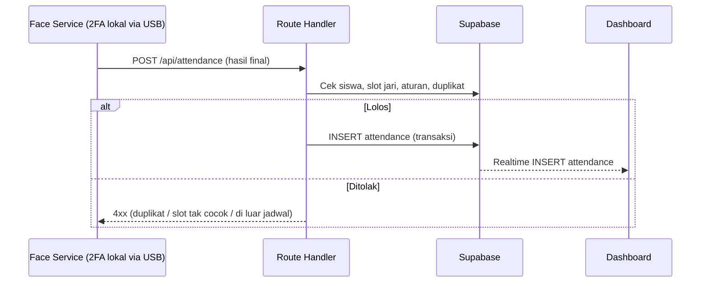

# Backend Cloud — Route Handler Next.js + Supabase

> **Aktif (2026-10-20)** — cloud menerima **hasil final 2FA** dari face service lokal (wajah + jari sudah diputus di PC via USB Serial), lalu validasi aturan + simpan. Tanpa antrean perintah, tanpa `command_id`, tanpa WebSocket gateway custom. Versi lama (NestJS + polling) diarsipkan di [`archive/wifi-polling/backend.md`](archive/wifi-polling/backend.md).

## Tanggung Jawab dan Batas Integrasi

Route Handler Next.js + Supabase bertugas:

- Menerima hasil final absensi dari face service lokal.
- Memvalidasi jadwal, kelas, dan aturan absensi.
- Menyimpan transaksi absensi secara konsisten ke Supabase PostgreSQL.
- Mengautentikasi perangkat/pengguna dan melayani dashboard (REST + Realtime).

**Batas:** cloud tidak melakukan pemrosesan citra (tugas face service), tidak mengendalikan sensor fingerprint (tugas face service via USB Serial), dan tidak menentukan tampilan (tugas dashboard).

Dokumen terkait: [architecture.md](architecture.md), [face-recognition.md](face-recognition.md), [fingerprint.md](fingerprint.md), [database.md](database.md), [communication-flow.md](communication-flow.md).

## Validasi Hasil Final dari Face Service

Saat menerima `POST /api/attendance`, Route Handler:

1. Memverifikasi autentikasi perangkat (device ID + kredensial).
2. Memvalidasi struktur payload (`student_id`, `face_confidence`, `fingerprint_slot`, `fingerprint_score`).
3. Memeriksa `student_id` ada dan terdaftar di kelas yang relevan.
4. Memeriksa relasi `student_id ↔ fingerprint_slot` sesuai database (anti wajah-A-jari-B).
5. Memeriksa siswa belum tercatat absen hari itu (idempotensi).
6. Jika lolos → INSERT `attendance` + siarkan event Realtime.

## Validasi Jadwal, Kelas, dan Aturan Absensi

Rancangan aturan (nilai pasti `TBD`):

1. Waktu absen berada dalam jadwal pelajaran/kelas yang sedang berjalan.
2. Siswa terdaftar (enrolled) di kelas tersebut.
3. Jendela waktu absensi (mis. X menit sebelum–Y menit setelah jam mulai).
4. Belum ada absensi sah siswa pada sesi/pelajaran yang sama.
5. Keterlambatan dapat ditandai (status `late`) — `TBD`.

## Penyimpanan Transaksi Absensi

- Insert ke tabel `attendance` dalam satu transaksi database.
- Pencegahan duplikat: constraint unik `(student_id, class_id, date)` + pengecekan aplikasi — detail di [database.md](database.md).
- Setelah tersimpan, Supabase menyiarkan `postgres_changes` (INSERT `attendance`) ke dashboard.

## Autentikasi Perangkat, Otorisasi, dan HTTPS

- Semua face-service/ESP32-Kursi → cloud memakai HTTPS; perangkat mengenali diri dengan `device_id` + kredensial, bukan IP lokal.
- Kredensial disimpan di backend dalam bentuk hash.
- Endpoint terbagi per peran: perangkat hanya boleh endpoint perangkat; dashboard memakai Supabase Auth — skema detail `TBD`.
- Face service diperlakukan sebagai "perangkat" kelas dengan kredensialnya sendiri.

## Endpoint Konseptual

> **Rancangan — Belum diimplementasikan.** Nama path final mengikuti App Router Next.js.

| Grup | Method & Path (rancangan) | Fungsi |
|---|---|---|
| Attendance | `POST /api/attendance` | Terima hasil final 2FA dari face service |
| Attendance | `GET /api/attendance` | Daftar absensi (dashboard) |
| Attendance | `POST /api/attendance/manual` | Koreksi manual operator — `TBD` |
| Seat status | `POST /api/seats/status` | ESP32 kursi melaporkan status (Wi-Fi) |
| Enrollment | `POST /api/students/{id}/face-status` | Callback status enrollment wajah |
| Enrollment | `PATCH /api/students/{id}` | Update `fingerprint_slot` setelah enroll serial |
| Realtime | Supabase channel | Event ke dashboard (tanpa WS custom) |

### Contoh `POST /api/attendance` (request dari face service)

```json
{
  "device_id": "class-pc-01",
  "student_id": "STD-2024-001",
  "face_confidence": 0.71,
  "fingerprint_slot": 12,
  "fingerprint_score": 180,
  "captured_at": "2026-10-20T07:01:22+07:00"
}
```

### Contoh respons → `201 Created`

```json
{
  "attendance_id": "a1b2c3d4-...",
  "status": "present",
  "date": "2026-10-20"
}
```

## Diagram Sequence Proses Absensi



## Idempotensi, Retry, dan Penanganan Kegagalan

| Aspek | Penanganan |
|---|---|
| Hasil final terkirim ganda (retry) | Ditolak constraint unik DB + cek aplikasi — tanpa sesi ganda |
| Absensi duplikat | Ditolak constraint unik `(student_id, class_id, date)` |
| Wajah ≠ jari (slot tak cocok) | Ditolak 422 + log audit |
| Retry perangkat | Exponential backoff dengan jitter |
| Internet terputus | Face service buffer lokal terbatas, kirim ulang saat online |
| Layanan backend down | Face service retry; dashboard banner error |

## Integrasi Realtime dengan Dashboard

- Supabase menyiarkan: INSERT/UPDATE `attendance`, UPDATE `seat_status`, UPDATE `devices`.
- Dashboard berlangganan channel per kelas/hak akses.
- Reconnect otomatis di sisi klien; data terlewat diambil ulang via REST.

## Fallback Wi-Fi Polling (Arsip)

Spesifikasi antrean perintah (`device_commands`, `command_id`, polling ESP32) tersimpan di [`archive/wifi-polling/backend.md`](archive/wifi-polling/backend.md) untuk skenario kabel USB tidak sampai.
