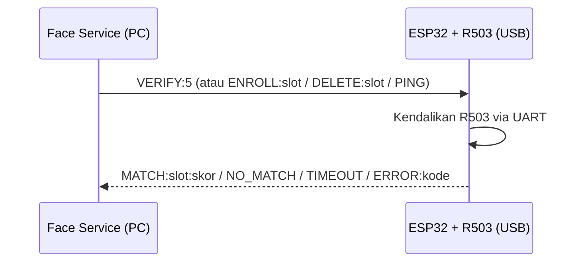
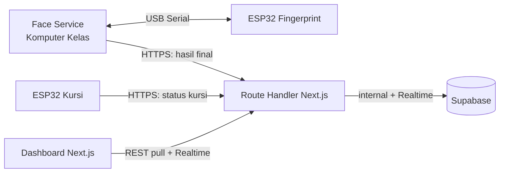

# Communication Flow — Komunikasi Antarkomponen

> **Aktif (2026-10-20)** — rute utama: face service ↔ ESP32 Fingerprint via **USB Serial**; face service → cloud via HTTPS; ESP32 Kursi → cloud via HTTPS. Versi Wi-Fi polling lama diarsipkan di [`archive/wifi-polling/communication-flow.md`](archive/wifi-polling/communication-flow.md).

## Prinsip Dasar

1. Route Handler Next.js berjalan **online** dengan endpoint HTTPS publik.
2. Komponen kelas yang memakai jaringan (face service, ESP32 Kursi) **hanya memulai koneksi keluar** — tanpa port forwarding, tanpa perubahan router/Wi-Fi.
3. ESP32 Fingerprint **tidak memakai jaringan sama sekali** — kabel USB langsung ke laptop.
4. Identitas perangkat cloud memakai **device ID + kredensial**, bukan alamat IP lokal.
5. Yang memulai permintaan menentukan arah data — lihat diagram di bawah.

## Pola Komunikasi per Rute

| Rute | Protokol | Pemulai | Catatan |
|---|---|---|---|
| Face service ↔ ESP32 Fingerprint | USB Serial (`pyserial`, 115200 baud) | Face service | `VERIFY`/`ENROLL`/`DELETE`/`PING` → `MATCH`/`NO_MATCH`/`TIMEOUT`/`ERROR`; latensi ms |
| Face service → Route Handler | HTTPS REST | Face service | 1 hasil final 2FA per absensi; retry saat gagal |
| ESP32 Kursi → Route Handler | HTTPS POST berkala | ESP32 Kursi | Status kursi; interval di `app_config` |
| Route Handler ↔ Supabase | Koneksi internal + Realtime | Keduanya | Bukan lewat internet publik |
| Route Handler → Dashboard | REST + Supabase Realtime | Dashboard (REST) / Supabase (push) | Data awal via REST, update via Realtime |

### Face Service ↔ ESP32 Fingerprint (USB Serial)

- Terminator baris `\n`; timeout baca serial = timeout perintah + 1 detik.
- Kabel lepas → `SerialException` → tandai `offline` lokal → auto-reconnect saat dicolok ulang.
- Detail perintah: [fingerprint.md](fingerprint.md).

### Face Service → Route Handler (Hasil Final)

- `POST /api/attendance` berisi `student_id`, `face_confidence`, `fingerprint_slot`, `fingerprint_score` (rancangan).
- Respons: record tersimpan atau ditolak (duplikat/aturan).
- Retry: exponential backoff + jitter; buffer lokal terbatas saat internet putus.

### ESP32 Kursi → Route Handler

- `POST /api/seats/status` berkala (Wi-Fi sekolah, outbound).
- Interval dan ambang offline di `app_config` (`device_offline_seconds`).

### Route Handler → Dashboard Next.js

- REST untuk data awal dan riwayat (dashboard memulai).
- Supabase Realtime (`postgres_changes` pada `attendance`, `seat_status`, `devices`) untuk push (detail di [dashboard.md](dashboard.md)).

## Autentikasi Perangkat

- Setiap perangkat cloud punya `device_id` unik + kredensial rahasia di Supabase (lihat [database.md](database.md)).
- Kredensial dikirim pada setiap permintaan HTTPS (header/token — skema pasti `TBD`); backend memverifikasi sebelum memproses.
- Perangkat serial lokal (ESP32-FP) tidak butuh kredensial cloud — akses fisik ke kabel USB adalah batas keamanannya; enrollment tetap butuh operator terautentikasi di sisi PC.
- Alamat IP lokal **tidak** dipakai sebagai identitas.

## Diagram Arah Komunikasi

Panah HTTPS keluar dari jaringan sekolah selalu **dimulai perangkat kelas** — tidak ada koneksi masuk dari internet. Jalur USB tidak menyentuh jaringan sama sekali.

## Retry, Timeout, dan Internet Terputus

| Skenario | Penanganan |
|---|---|
| USB Serial timeout / kabel lepas | Batalkan sesi lokal; tandai `offline`; auto-reconnect |
| POST hasil final gagal/timeout | Retry exponential backoff; buffer lokal terbatas; kirim ulang saat pulih |
| ESP32 Kursi gagal POST | Coba interval berikutnya; tandai offline setelah ambang batas |
| Sesi 2FA lokal kedaluwarsa (30 dtk) | Tandai `expired`; tanpa pengiriman cloud |
| Internet sekolah putus total | Buffer lokal terbatas; absensi saat putus tidak real-time |
| Backend down | Face service retry; dashboard banner error |
| Realtime dashboard putus | Reconnect otomatis; refresh via REST agar tidak ada event terlewat |
| Kredensial tidak valid | Tolak permintaan; tandai perangkat untuk ditinjau |

## Fallback Wi-Fi Polling (Arsip)

Bila kabel USB tidak sampai di lokasi: ESP32 Fingerprint diganti firmware Wi-Fi polling (`GET /devices/{id}/commands` + `POST command-results`, tabel `device_commands`). Spesifikasi lengkap di [`archive/wifi-polling/communication-flow.md`](archive/wifi-polling/communication-flow.md).

## Catatan Implementasi

- USB Serial adalah **pilihan utama** karena latency ms + tanpa ketergantungan Wi-Fi untuk faktor kedua.
- Semua komunikasi cloud memakai HTTPS/TLS; sertifikat dan domain `TBD`.
- Payload JSON ringkas agar murah.
