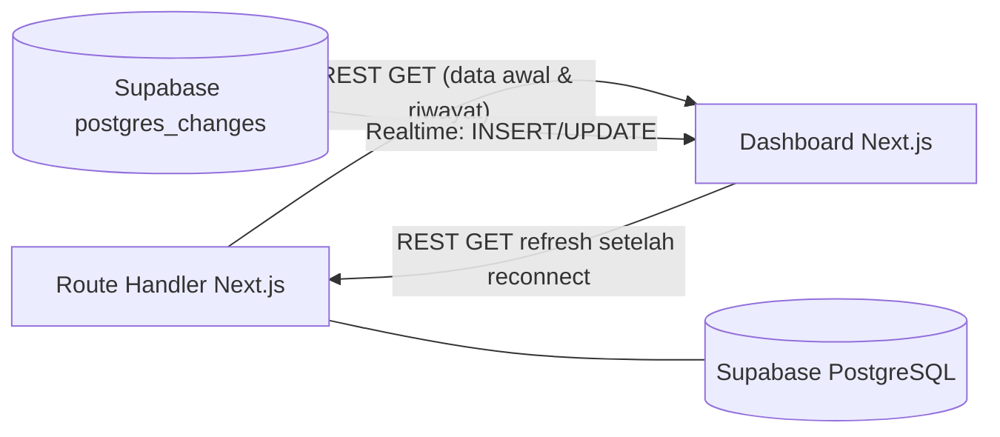

# Dashboard — Next.js + React

> **Rancangan** — halaman, endpoint, dan format event belum diimplementasikan.

## Tujuan

Dashboard adalah antarmuka monitoring untuk operator/guru: melihat kehadiran real-time, riwayat, status kursi, dan rekap. Dashboard **tidak** mencatat absensi; semua data berasal dari Route Handler Next.js + Supabase.

Dokumen terkait: [backend.md](backend.md), [database.md](database.md), [communication-flow.md](communication-flow.md).

## Teknologi

| Teknologi | Fungsi |
|---|---|
| Next.js | Framework React: routing halaman, SSR/ISR untuk data awal — mode render pasti `TBD` |
| React | Komponen UI tabel, kartu status, grafik rekap |
| REST API (dari backend) | Pengambilan data awal dan riwayat |
| Supabase Realtime (`postgres_changes`) | Pembaruan real-time tanpa refresh (tanpa WebSocket gateway custom) |

## Halaman Monitoring Kehadiran (rancangan)

Halaman utama menampilkan, per kelas yang diikuti:

1. Daftar siswa + status absensi hari ini (`present` / `late` / belum absen).
2. Sesi verifikasi yang sedang berjalan (menunggu fingerprint) — opsional, `TBD`.
3. Status kursi per siswa/kursi (`occupied` / `empty` / `unknown`).
4. Notifikasi perangkat offline / sensor error.

## Data Siswa dan Riwayat Absensi

- Pencarian dan filter berdasar nama/NIS/kelas/tanggal.
- Riwayat per siswa: daftar absensi terverifikasi dengan waktu dan metode.
- Sumber: `GET /api/v1/attendance` (rancangan) dengan paginasi — detail di [backend.md](backend.md).

## Status Verifikasi

Status yang ditampilkan per percobaan absensi (rancangan): `pending`/`verified`/`rejected` (wajah ≠ jari)/`expired`/`no_match`. Pada topologi USB ada juga sinyal serial lokal (`MATCH`/`TIMEOUT`/`ERROR` di log face service) sebelum record final tersimpan. Operator dapat melihat mengapa seorang siswa belum tercatat absen.

## Status Kursi

- Tampilan denah/peta kursi (opsional, `TBD`) atau tabel status.
- Status kursi disajikan **sebagai informasi pendukung**, bukan kehadiran — lihat [iot-monitoring.md](iot-monitoring.md).
- Data basi (perangkat lama tidak melapor) ditandai "data lama", bukan dianggap valid.

## Rekap Kehadiran

- Rekap per kelas/hari/bulan: jumlah hadir, terlambat, tanpa keterangan.
- Ekspor CSV/PDF — `TBD`.
- Perhitungan dilakukan backend (agregasi SQL), dashboard hanya menampilkan.

## Integrasi REST API dan Supabase Realtime

**Alur data cloud → dashboard:**



- Saat halaman dibuka: data awal diambil via REST, lalu klien berlangganan channel Realtime.
- Tabel yang didengarkan: `attendance` (INSERT/UPDATE), `seat_status` (UPDATE), `devices` (UPDATE).

Contoh payload Realtime `attendance` INSERT (kolom langsung, bukan pesan WS custom):

```json
{
  "attendance_id": "a1b2c3d4-...",
  "student_id": "STD-2024-001",
  "class_id": "XII-IPA-1",
  "status": "present",
  "check_in_at": "2026-10-20T07:02:30+07:00"
}
```

## Kondisi Loading, Error, dan Data Belum Tersedia

| Kondisi | Tampilan (rancangan) |
|---|---|
| Loading data awal | Skeleton/indikator memuat |
| REST gagal | Banner error + tombol coba lagi |
| Realtime terputus | Indikator koneksi; reconnect otomatis; refresh data via REST saat tersambung kembali |
| Belum ada absensi hari itu | Empty state yang jelas ("Belum ada data"), bukan angka nol yang menyesatkan |
| Perangkat offline | Badge peringatan pada kelas/perangkat terkait |

## Hak Akses Pengguna Dashboard

- Autentikasi pengguna (login) — mekanisme pasti `TBD` (rancangan: session/JWT dari backend).
- Peran kandidat: admin (semua kelas + pengelolaan), guru/operator (kelas yang diampu), pengamat (read-only) — final `TBD`.
- Dashboard tidak boleh dapat mengakses/mengunduh data biometrik mentah.
- Semua permintaan dashboard ke backend melewati otorisasi berbasis peran di sisi backend.
