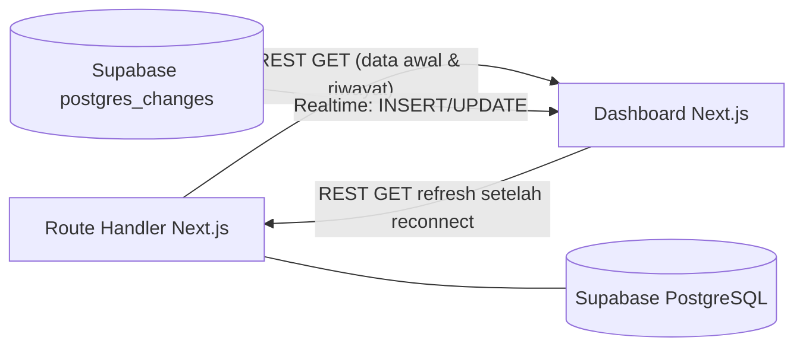

# Dashboard — Next.js + React

> **Rancangan** — halaman, endpoint, dan format event belum diimplementasikan.

## Tujuan

Dashboard adalah antarmuka monitoring untuk operator/guru: melihat kehadiran real-time, riwayat, status kursi, dan rekap. Dashboard **tidak** mencatat absensi; semua data berasal dari Route Handler Next.js + Supabase.

Dokumen terkait: [backend.md](backend.md), [database.md](database.md), [communication-flow.md](communication-flow.md).

## Teknologi

| Teknologi | Fungsi |
|---|---|
| Next.js | Framework React: routing halaman, SSR/ISR untuk data awal — mode render pasti `TBD` |
| React | Komponen UI tabel, kartu status, grafik rekap |
| REST API (dari backend) | Pengambilan data awal dan riwayat |
| Supabase Realtime (`postgres_changes`) | Pembaruan real-time tanpa refresh (tanpa WebSocket gateway custom) |

## Halaman Monitoring Kehadiran (rancangan)

Halaman utama menampilkan, per kelas yang diikuti:

1. Daftar siswa + status absensi hari ini (`present` / `late` / belum absen).
2. Sesi verifikasi yang sedang berjalan (menunggu fingerprint) — opsional, `TBD`.
3. Status kursi per siswa/kursi (`occupied` / `empty` / `unknown`).
4. Notifikasi perangkat offline / sensor error.

## Data Siswa dan Riwayat Absensi

- Pencarian dan filter berdasar nama/NIS/kelas/tanggal.
- Riwayat per siswa: daftar absensi terverifikasi dengan waktu dan metode.
- Sumber: `GET /api/v1/attendance` (rancangan) dengan paginasi — detail di [backend.md](backend.md).

## Status Verifikasi

Status yang ditampilkan per percobaan absensi (rancangan): `pending`/`verified`/`rejected` (wajah ≠ jari)/`expired`/`no_match`. Pada topologi USB ada juga sinyal serial lokal (`MATCH`/`TIMEOUT`/`ERROR` di log face service) sebelum record final tersimpan. Operator dapat melihat mengapa seorang siswa belum tercatat absen.

## Status Kursi

- Tampilan denah/peta kursi (opsional, `TBD`) atau tabel status.
- Status kursi disajikan **sebagai informasi pendukung**, bukan kehadiran — lihat [iot-monitoring.md](iot-monitoring.md).
- Data basi (perangkat lama tidak melapor) ditandai "data lama", bukan dianggap valid.

## Rekap Kehadiran

- Rekap per kelas/hari/bulan: jumlah hadir, terlambat, tanpa keterangan.
- Ekspor CSV/PDF — `TBD`.
- Perhitungan dilakukan backend (agregasi SQL), dashboard hanya menampilkan.

## Integrasi REST API dan Supabase Realtime

**Alur data cloud → dashboard:**



- Saat halaman dibuka: data awal diambil via REST, lalu klien berlangganan channel Realtime.
- Tabel yang didengarkan: `attendance` (INSERT/UPDATE), `seat_status` (UPDATE), `devices` (UPDATE).

Contoh payload Realtime `attendance` INSERT (kolom langsung, bukan pesan WS custom):

```json
{
  "attendance_id": "a1b2c3d4-...",
  "student_id": "STD-2024-001",
  "class_id": "XII-IPA-1",
  "status": "present",
  "check_in_at": "2026-10-20T07:02:30+07:00"
}
```

## Kondisi Loading, Error, dan Data Belum Tersedia

| Kondisi | Tampilan (rancangan) |
|---|---|
| Loading data awal | Skeleton/indikator memuat |
| REST gagal | Banner error + tombol coba lagi |
| Realtime terputus | Indikator koneksi; reconnect otomatis; refresh data via REST saat tersambung kembali |
| Belum ada absensi hari itu | Empty state yang jelas ("Belum ada data"), bukan angka nol yang menyesatkan |
| Perangkat offline | Badge peringatan pada kelas/perangkat terkait |

## Hak Akses Pengguna Dashboard

- Autentikasi pengguna (login) — mekanisme pasti `TBD` (rancangan: session/JWT dari backend).
- Peran kandidat: admin (semua kelas + pengelolaan), guru/operator (kelas yang diampu), pengamat (read-only) — final `TBD`.
- Dashboard tidak boleh dapat mengakses/mengunduh data biometrik mentah.
- Semua permintaan dashboard ke backend melewati otorisasi berbasis peran di sisi backend.

## Status Implementasi UI (2026-10-20, update malam)

- **Overview live:** `page.tsx` container fetch `GET /api/dashboard/overview-summary?class_id&date` + subscribe Realtime `attendance`/`seat_status`/`devices` (refetch ringan). Komponen (`KpiCards`, `DetailCards`, `Topbar`) presentasional terima props.
- **Route Handler:** `src/app/api/dashboard/overview-summary/route.ts` agregasi server-side via service-role (aman, secret tidak ke browser): total/present/late/absent (absent = turunan tanpa baris), bucket kursi occupied/empty/unknown, device + flag `stale` (> `device_offline_seconds`), recent 10.
 - **Verifikasi:** `tsc --noEmit` bersih ✅; `npm run build` sukses (`/` 72.1 kB, route API dynamic) ✅; serve prod :3105 → API return `XII-RPL-1, total 2, absent 2, seats 2 empty, device offline/stale` ✅.
 - **Attendance (2026-10-21 dini hari):** `src/app/attendance/page.tsx` replika `design/Attendance.png` — tabel 2FA (`sess-9921` dkk) + modal inspeksi pipeline 6-langkah (YuNet→SFace→Serial ESP32→R503→Supabase commit→final), filter/search/export-CSV client-side, pagination 1-dari-24, fallback mock jika Supabase kosong. Route `GET /api/attendance?class_id&date&search&page&limit` via service-role. Topbar terima `pageTitle` (`Overview` di `/`, `Attendance` di `/attendance`). Mobile (<md) daftar kartu, desktop tabel. Bukti: desk+mobile screenshot + modal OK ✅.
 - **Pipeline absensi 2FA (2026-11-02):** `POST /api/attendance` menjadi Otak Penentu Absensi — verifikasi sesi server-side (`verified` + `matched_slot == students.fingerprint_slot` + `verified_at` ≤ 120 dtk anti-replay), status present/late via `app_config.late_threshold` WIB, upsert idempoten (`student_id,class_id,date`), insert-only untuk audit `failed`/`expired` agar tidak menimpa baris sah, konsumsi sesi 1x + `POST /fingerprint/led` (kedip hijau ESP32). `GET` tambah filter `status`. `/camera` memanggil POST saat 2FA terminal + banner hasil + cooldown 30 dtk + auto-reset 3.5 dtk. `/attendance` tampilkan baris nyata + filter status. E2E (serial palsu): verified → 1 baris tercatat, replay 409, scan ganda idempoten, sesi terkonsumsi ✅; `tsc` + `build` bersih ✅; port stale root `.env.local` `:8000` → `:8200` (2026-11-02).
- **Students Management (`/students` & `/students/enroll` - 2026-10-22):**
  - **Tabel Induk (`/students`):** Daftar siswa dengan status biometrik (Wajah .npz, Jari Slot #, Agregat 2FA), filter status/search, tombol **"Tambah Siswa"** (modal insert langsung ke Supabase `students`), aksi per baris **"Scan Wajah"** yang otomatis pre-fill ke form enroll, dan **"Hapus"** permanen. Route `GET/POST/DELETE /api/students`.
  - **Hapus permanen (2026-11-01):** `DELETE /api/students?student_id=X` menghapus 3 lapis — purge embedding `:8200/enroll/{id}` → hapus `attendance` terkait → hapus baris `students`. Gagal purge (service down / non-404) → 502 dan batal, supaya tidak ada wajah yatim yang masih ikut `recognize()`. Masa testing sengaja hard delete, bukan `is_active=false`.
  - **Face Enrollment (`/students/enroll`):** Dropdown kandidat dari Supabase (A1), tangkapan 5 sudut wajah (YuNet + SFace), sinkronisasi otomatis ke `students.face_status='enrolled'` (A2), dan rollback otomatis bila update DB gagal sehingga tidak pernah ada embedding yatim di `.npz` (A3).
 - **Settings (`/settings` - 2026-11-16):** form `app_config` (3 grup: aturan absensi, ambang perangkat/sensor, zona waktu) via `GET/POST /api/settings`; hanya 8 key yang benar-benar dibaca Route Handler, key asing ditolak. Simpan per-key (berhenti di kegagalan pertama, draft dipertahankan). Sisa PRD menu 7 (users, kredensial perangkat, koreksi manual) tampil disabled "Planned".
- **Reports (`/reports` - 2026-11-17):** agregasi server-side `GET /api/reports/summary?class_id&from&to` (maks 92 hari): ringkasan periode (present/late/failed/expired/absent + attendance rate = hadir ÷ siswa aktif × hari), rekap harian, tren kehadiran per hari, okupansi kursi dari `seat_events` (distinct kursi `occupied` per hari ÷ kursi terpantau; tabel hilang → empty state, tanpa estimasi), dan log konektivitas perangkat mentah (`status` + `last_seen_at`; riwayat offline/uptime belum ada tabelnya). Absent = siswa aktif tanpa baris `present`/`late` hari itu (baris `failed`/`expired` tidak dihitung hadir maupun absen). Ekspor CSV ringkasan + rekap harian, nama file `reports-<kelas>-<from>_<to>.csv`; tombol export nonaktif saat data belum tampil (PRD §4.5). Tanpa Realtime (read-mostly).
 - **Verifikasi:** `tsc` bersih ✅; `next build` sukses (`/reports` 7.77 kB) ✅; uji live `:3000` — 7 hari (5 siswa, rate 2.9%, absent 34, late 1), preset 30 hari (30 baris), CSV 925 B isi cocok, okupansi 7.1% (2 kursi), badge device online/offline tampil ✅.
- **Login/Auth (`/login` - 2026-11-18):** autentikasi Supabase Auth dengan sesi cookie httpOnly via `@supabase/ssr` 0.12.7. `src/middleware.ts` menjaga semua halaman (`/api/*` dikecualikan karena face service & ESP32 belum punya kredensial perangkat): tanpa sesi → `/login?next=<path>` (+ `expired=1` bila cookie sesi lama masih ada, memunculkan "Sesi berakhir, silakan login kembali"); sudah login membuka `/login` → redirect `/`. Form login memakai pesan generik "Email atau password salah" (tanpa enumerasi akun), toggle tampil password, dan memvalidasi role/status lewat `GET /api/auth/me` (profiles: `full_name`, `role`, `is_active`) sebelum masuk — akun tanpa profil atau `is_active=false` langsung di-signOut dengan pesan "Akun dinonaktifkan". Topbar menampilkan nama + role asli dari `/api/auth/me` dan menu profil berisi tombol **Keluar** (`POST /api/auth/signout`).
  - **Verifikasi:** `tsc` bersih ✅; `next build` sukses (`/login` 2.2 kB, middleware 92.4 kB) ✅; uji live — `/` tanpa sesi → 307 `/login?next=%2F`, password salah → pesan generik, login benar → `/settings` (return URL) dengan Topbar "Admin AICI / ADMIN", logout → `/login`, `/attendance` setelah logout → redirect `next=%2Fattendance`, cookie sesi palsu → pesan sesi berakhir ✅.
  - **Akun uji:** `admin@aici.sch.id` (role `admin`, password diganti lewat dashboard Supabase sebelum dipakai).
  - **Belum:** rate limiting/lockout (PRD §4.4 `TBD`), reset password mandiri, auto-logout idle, UI manajemen sesi aktif, RBAC per halaman (baru ditampilkan, belum menolak akses).
- **Sisa:** `Devices` (`/devices`); firmware ESP32 R503 (B1-B5), firmware kursi HX711.
