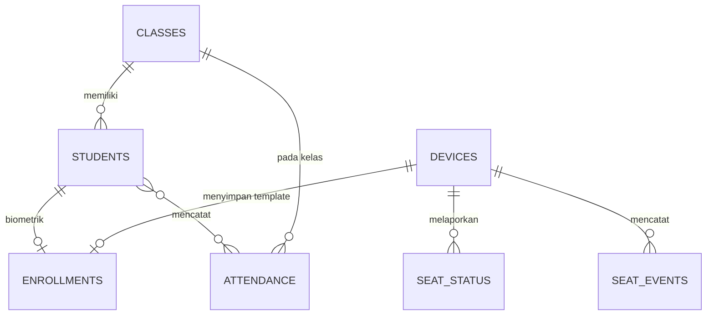

# Database — Rancangan Data PostgreSQL

> **Rancangan awal** — entitas di bawah belum final dan perlu disesuaikan dengan kebutuhan aktual implementasi. Belum ada migrasi/schema yang diverifikasi.

## Tujuan

Dokumen ini menjelaskan kandidat entitas PostgreSQL untuk Smart Classroom Attendance, fungsi masing-masing, relasi, dan aturan pencegahan absensi duplikat.

Dokumen terkait: [backend.md](backend.md), [iot-monitoring.md](iot-monitoring.md), [dashboard.md](dashboard.md).

## Kandidat Entitas

### 1. Students

Data siswa. Primary key `student_id`. Kolom kandidat: nama, NIS, `class_id` (kelas utama), status aktif.

> Jangan menyimpan password mentah. Bila sistem memiliki akun (siswa/operator), simpan hash password dengan algoritma modern (argon2/bcrypt) — skema akun `TBD`.

### 2. Classes

Data kelas (mis. `XII-IPA-1`). Primary key `class_id`. Kolom kandidat: nama kelas, tingkat, tahun ajaran.

### 3. Enrollments / BiometricRefs

Referensi data biometrik per siswa. Ada dua jenis:

- **Face embedding**: diproses FastAPI lokal. Lokasi penyimpanan embedding `TBD` (lokal di komputer kelas vs di backend) — keputusan arsitektur yang terbuka; bila di backend, jangan pernah diekspos ke pengguna tidak berwenang.
- **Fingerprint template mapping**: relasi `student_id ↔ template_id ↔ device_id`. Template fisik tersimpan di sensor R503; database hanya menyimpan pemetaannya.

### 4. Devices

Perangkat terdaftar (komputer kelas, ESP32 fingerprint, ESP32 kursi). Primary key `device_id`. Kolom kandidat: tipe perangkat, lokasi/kelas, hash kredensial, status (online/offline), terakhir terlihat.

### 5. Attendance

Catatan absensi hasil verifikasi. Primary key `attendance_id`. Kolom kandidat: `student_id`, `class_id`, tanggal+jam, metode (`face+fingerprint`), status (`present`/`late`/`TBD`), referensi sesi verifikasi.

### 6. SeatStatus / SeatEvents

- **SeatStatus** (keadaan terkini): `seat_id`, `device_id`, status (`empty`/`occupied`/`unknown`), berat terakhir, waktu update — satu baris per kursi.
- **SeatEvents** (riwayat perubahan): event `seat_id`, status lama→baru, timestamp. Memungkinkan rekonstruksi riwayat okupansi.

## Relasi Antar Entitas

## Primary Key, Foreign Key, dan Indeks (rancangan)

| Tabel | PK | FK kandidat | Indeks kandidat |
|---|---|---|---|
| Students | `student_id` | `class_id → Classes` | unik pada NIS; `class_id` |
| Classes | `class_id` | — | unik pada nama kelas+tahun ajaran |
| Enrollments | `enrollment_id` | `student_id`, `device_id` | unik `student_id` per jenis biometrik |
| Devices | `device_id` | — | unik `device_id`; indeks status |
| Attendance | `attendance_id` | `student_id`, `class_id` | **unik `(student_id, class_id, date)`**; indeks `(class_id, date)` untuk rekap |
| SeatStatus | `seat_id` | `device_id` | — |
| SeatEvents | `event_id` | `seat_id` | indeks `(seat_id, timestamp)` |

## Pencegahan Absensi Duplikat

1. **Constraint unik** `(student_id, class_id, date)` (atau per sesi pelajaran — granularitas final `TBD`) di tabel Attendance.
2. **Cek aplikasi** sebelum insert di backend (cepat, ramah pesan error).
3. **Idempotensi command/session**: `command_id` unik mencegah hasil ESP32 ganda tercatat dua kali.
4. Database adalah penjaga terakhir: insert duplikat tetap gagal meski cek aplikasi terlewat (race condition).

## Privasi dan Keamanan Data

- Data biometrik (embedding, pemetaan template) **MUST NOT** dikembalikan ke pengguna tidak berwenang; hanya proses verifikasi yang membacanya.
- Kredensial perangkat disimpan sebagai hash, bukan plaintext.
- Jangan pernah menaruh data biometrik asli, password, atau token dalam dump/seed yang di-commit ke repository.
- Penghapusan siswa harus menarik data biometrik terkait (lihat [face-recognition.md](face-recognition.md) dan [fingerprint.md](fingerprint.md)).

## Catatan Implementasi

- Semua skema di atas adalah kandidat; migrasi aktual (mis. Prisma/MikroORM di NestJS) `TBD`.
- Penomoran `TBD`: timestamp disimpan dalam UTC atau waktu lokal — harus konsisten di seluruh sistem.
- Jumlah kursi yang dipantau (semua kursi vs sampel) `TBD` — memengaruhi ukuran tabel SeatStatus/SeatEvents.
