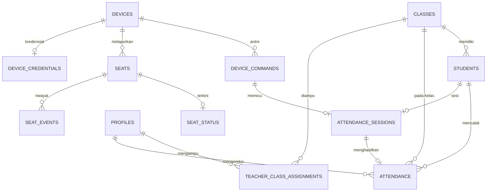

# Database — Skema PostgreSQL Supabase

> **Final (2026-10-20)** — skema acuan implementasi. Backend: satu project Next.js full-stack (Route Handlers `/api/*`) + Supabase (PostgreSQL + Auth + Realtime). Tanpa NestJS, tanpa WebSocket gateway custom.

Dokumen terkait: [architecture.md](architecture.md), [backend.md](backend.md), [iot-monitoring.md](iot-monitoring.md), [dashboard.md](dashboard.md).

## Keputusan Skema yang Dikunci

| Keputusan | Pilihan | Alasan |
|---|---|---|
| Embedding wajah | Hanya di PC kelas (lokal) | Data biometrik tidak melintasi internet; Supabase hanya simpan status/metadata enrollment |
| Granularitas absensi | Per siswa/kelas/hari | Unique `(student_id, class_id, date)`; cocok untuk absensi pagi |
| Relasi guru–kelas | Junction table `teacher_class_assignments` | Dukung banyak kelas per guru; RLS bersih |
| Status `absent` | Turunan, bukan baris | Siswa tanpa baris `attendance` pada tanggal aktif = absen |
| Timestamp | `timestamptz` (simpan UTC), kolom `date` pakai zona `Asia/Jakarta` | Konsisten lintas PC kelas, ESP32, dan server |

## 1. Students

Data induk siswa. Embedding wajah **tidak** disimpan di sini (tetap di PC kelas).

| Kolom | Tipe | Constraint | Keterangan |
|---|---|---|---|
| `student_id` | `text` | PK | NIS, mis. `STD-2024-001` |
| `full_name` | `text` | NOT NULL | Nama lengkap |
| `class_id` | `text` | FK → `classes`, NOT NULL | Kelas utama |
| `gender` | `text` | CHECK (`L`/`P`) | Nullable |
| `guardian_contact` | `text` | — | Kontak wali, nullable |
| `face_status` | `text` | NOT NULL DEFAULT `'not_enrolled'` | `not_enrolled`/`pending`/`enrolled` |
| `fingerprint_status` | `text` | NOT NULL DEFAULT `'not_enrolled'` | `not_enrolled`/`pending`/`enrolled` |
| `face_enrolled_at` | `timestamptz` | — | Waktu enrollment wajah |
| `fingerprint_slot` | `smallint` | — | Slot template di R503 (ID saja, tanpa citra/template) |
| `is_active` | `boolean` | NOT NULL DEFAULT `true` | Nonaktif = soft delete |
| `created_at` | `timestamptz` | NOT NULL DEFAULT `now()` | Audit |
| `updated_at` | `timestamptz` | NOT NULL DEFAULT `now()` | Audit |

Indeks: unique `student_id` (PK); indeks `class_id`.

## 2. Classes

| Kolom | Tipe | Constraint | Keterangan |
|---|---|---|---|
| `class_id` | `text` | PK | Mis. `CLS-10-RPL-1` |
| `name` | `text` | NOT NULL | Nama tampil |
| `grade_level` | `text` | — | Tingkat |
| `academic_year` | `text` | — | Mis. `2026/2027` |
| `room` | `text` | — | Lokasi ruangan |
| `capacity` | `smallint` | — | Kapasitas kursi |
| `is_active` | `boolean` | NOT NULL DEFAULT `true` | |

Unique `(name, academic_year)`.

## 3. Profiles (staf, gandeng Supabase Auth)

Satu baris per user Supabase Auth. Role dipakai Route Handler + RLS untuk RBAC.

| Kolom | Tipe | Constraint | Keterangan |
|---|---|---|---|
| `user_id` | `uuid` | PK, FK → `auth.users(id)` ON DELETE CASCADE | ID dari Supabase Auth |
| `email` | `text` | UNIQUE NOT NULL | Identifier login |
| `full_name` | `text` | NOT NULL | Nama staf |
| `role` | `text` | NOT NULL CHECK (`admin`/`teacher`/`observer`) | Lihat matriks di PRD |
| `is_active` | `boolean` | NOT NULL DEFAULT `true` | Nonaktif = login ditolak di middleware |

## 4. Teacher Class Assignments (junction guru–kelas)

| Kolom | Tipe | Constraint | Keterangan |
|---|---|---|---|
| `user_id` | `uuid` | PK komposit, FK → `profiles` ON DELETE CASCADE | Guru |
| `class_id` | `text` | PK komposit, FK → `classes` ON DELETE CASCADE | Kelas binaan |

## 5. Devices

| Kolom | Tipe | Constraint | Keterangan |
|---|---|---|---|
| `device_id` | `text` | PK | Mis. `CLASS-A-FP-01` |
| `name` | `text` | NOT NULL | Nama tampil |
| `type` | `text` | NOT NULL CHECK (`face_computer`/`fingerprint_esp32`/`seat_esp32`) | Jenis perangkat |
| `class_id` | `text` | FK → `classes` | Penempatan |
| `credential_hash` | `text` | — | Hash secret; Admin-only via RLS, tidak pernah ke klien |
| `status` | `text` | NOT NULL DEFAULT `'offline'` | `online`/`offline` |
| `firmware_version` | `text` | — | Versi firmware/layanan |
| `last_seen_at` | `timestamptz` | — | Heartbeat terakhir |
| `last_data_at` | `timestamptz` | — | Data terakhir |
| `is_active` | `boolean` | NOT NULL DEFAULT `true` | |

Indeks pada `status` untuk filter offline.

## 6. Device Commands (FALLBACK Wi-Fi saja — JANGAN buat di setup utama)

> **Arsitektur utama USB Serial TIDAK memakai tabel ini.** 2FA diputus di face service lokal; cloud menerima 1 hasil final. Buat tabel ini **hanya** bila lokasi memaksa fallback Wi-Fi polling (kabel USB tidak sampai). DDL lengkap dipertahankan di bawah + arsip [`archive/wifi-polling/database.md`](archive/wifi-polling/database.md) agar skenario cadangan tetap bisa dibangun tanpa menebak ulang.

### DDL fallback (jalankan hanya untuk skenario Wi-Fi)

ESP32 mengambil perintah via polling `GET /api/devices/{id}/commands?status=queued`.

| Kolom | Tipe | Constraint | Keterangan |
|---|---|---|---|
| `command_id` | `uuid` | PK DEFAULT `gen_random_uuid()` | Idempotensi hasil ESP32 |
| `device_id` | `text` | FK → `devices`, NOT NULL | Target |
| `type` | `text` | NOT NULL CHECK (`verify`/`enroll`/`test`) | Jenis perintah |
| `student_id` | `text` | FK → `students` | Nullable (tipe `test` tanpa siswa) |
| `status` | `text` | NOT NULL DEFAULT `'queued'` | `queued`/`picked_up`/`awaiting_result`/`completed`/`expired` |
| `payload` | `jsonb` | — | Mis. `{"slot": 12}` untuk enroll |
| `result` | `jsonb` | — | Hasil laporan ESP32 |
| `created_at` | `timestamptz` | NOT NULL DEFAULT `now()` | |
| `picked_up_at` | `timestamptz` | — | Diambil ESP32 |
| `completed_at` | `timestamptz` | — | Selesai/kedaluwarsa |

Indeks `(device_id, status)` untuk polling.

## 7. Attendance Sessions (FALLBACK Wi-Fi atau audit lokal)

> **Pada topologi USB Serial:** 2FA diselesaikan secara lokal di memory PC selama ≤30 detik. Hasil final langsung di-INSERT ke tabel `attendance`. Tabel ini **opsional** pada setup utama dan kolom `session_id` di tabel `attendance` dibuat `nullable` agar tidak memblokir penulisan. Tabel ini wajib aktif hanya bila arsitektur dikembalikan ke fallback Wi-Fi polling.

Satu sesi = satu upaya check-in. Frontend subscribe Realtime pada kolom `step` bila mode polling aktif.

| Kolom | Tipe | Constraint | Keterangan |
|---|---|---|---|
| `session_id` | `text` | PK | Mis. `sess-9921` |
| `student_id` | `text` | FK → `students`, NOT NULL | Kandidat wajah dari FastAPI |
| `class_id` | `text` | FK → `classes`, NOT NULL | |
| `face_confidence` | `real` | — | Skor SFace (numerik saja) |
| `fingerprint_command_id` | `uuid` | FK → `device_commands` | Perintah verify terkait |
| `step` | `text` | NOT NULL | `face_detected`/`waiting_fingerprint`/`verified`/`failed`/`expired` |
| `expires_at` | `timestamptz` | NOT NULL | Batas tunggu fingerprint (±30 dtk) |
| `created_at` | `timestamptz` | NOT NULL DEFAULT `now()` | |
| `updated_at` | `timestamptz` | NOT NULL DEFAULT `now()` | |

Indeks `(step, expires_at)` untuk job penanda `expired`.

## 8. Attendance (hasil final)

| Kolom | Tipe | Constraint | Keterangan |
|---|---|---|---|
| `attendance_id` | `uuid` | PK DEFAULT `gen_random_uuid()` | |
| `session_id` | `text` | UNIQUE, FK → `attendance_sessions`, nullable | `NULL` pada insert langsung 2FA lokal (UNIQUE Postgres mengizinkan banyak NULL); terisi pada fallback Wi-Fi (1 sesi → maks 1 record) |
| `student_id` | `text` | FK → `students`, NOT NULL | |
| `class_id` | `text` | FK → `classes`, NOT NULL | |
| `date` | `date` | NOT NULL | Tanggal absensi (zona `Asia/Jakarta`) |
| `check_in_at` | `timestamptz` | NOT NULL | Waktu check-in |
| `face_confidence` | `real` | — | Skor numerik saja |
| `fingerprint_slot` | `smallint` | — | Slot ID saja |
| `status` | `text` | NOT NULL CHECK (`present`/`late`/`failed`/`expired`) | |
| `corrected_by` | `uuid` | FK → `profiles` | Pengoreksi (Admin), nullable |
| `correction_reason` | `text` | — | Wajib diisi bila `corrected_by` terisi |
| `created_at` | `timestamptz` | NOT NULL DEFAULT `now()` | |

**Unique `(student_id, class_id, date)`** — database adalah penjaga terakhir anti duplikat.
Indeks `(class_id, date)` untuk rekap harian.

## 9. Seats (denah statis)

| Kolom | Tipe | Constraint | Keterangan |
|---|---|---|---|
| `seat_id` | `text` | PK | Mis. `SEAT-10-RPL-1-B03` |
| `class_id` | `text` | FK → `classes`, NOT NULL | |
| `device_id` | `text` | FK → `devices` | Modul ESP32 pelapor |
| `row_no` | `smallint` | — | Posisi baris denah |
| `col_no` | `smallint` | — | Posisi kolom denah |
| `is_monitored` | `boolean` | NOT NULL DEFAULT `true` | `false` = kursi tanpa sensor |

## 10. Seat Status (keadaan terkini, 1 baris per kursi)

| Kolom | Tipe | Constraint | Keterangan |
|---|---|---|---|
| `seat_id` | `text` | PK, FK → `seats` ON DELETE CASCADE | |
| `status` | `text` | NOT NULL CHECK (`empty`/`occupied`/`unknown`) | |
| `weight_kg` | `real` | — | Pembacaan terakhir |
| `updated_at` | `timestamptz` | NOT NULL DEFAULT `now()` | Dasar indikator stale |

Frontend subscribe Realtime tabel ini per `class_id`.

## 11. Seat Events (riwayat perubahan)

| Kolom | Tipe | Constraint | Keterangan |
|---|---|---|---|
| `event_id` | `uuid` | PK DEFAULT `gen_random_uuid()` | |
| `seat_id` | `text` | FK → `seats` ON DELETE CASCADE, NOT NULL | |
| `old_status` | `text` | — | Status sebelumnya |
| `new_status` | `text` | NOT NULL | Status baru |
| `weight_kg` | `real` | — | Berat pemicu |
| `created_at` | `timestamptz` | NOT NULL DEFAULT `now()` | |

Indeks `(seat_id, created_at)`.

## 12. Device Credentials

Kredensial perangkat terpisah dari tabel `devices` agar RLS Admin-only mudah dikunci.

| Kolom | Tipe | Constraint | Keterangan |
|---|---|---|---|
| `device_id` | `text` | PK, FK → `devices` ON DELETE CASCADE | |
| `secret_hash` | `text` | NOT NULL | Hash secret |
| `last_used_at` | `timestamptz` | — | Pemakaian terakhir |
| `rotated_at` | `timestamptz` | — | Rotasi terakhir |

Secret plaintext hanya tampil **sekali** saat rotate; tidak pernah dibaca kembali.

## 13. App Config

Pengaturan sistem key-value (dibaca Route Handler, dikelola via `/settings`).

| Kolom | Tipe | Constraint | Keterangan |
|---|---|---|---|
| `key` | `text` | PK | Mis. `attendance_window`, `late_threshold`, `verification_timeout`, `seat_occupied_kg`, `device_offline_seconds` |
| `value` | `jsonb` | NOT NULL | Nilai konfigurasi |
| `updated_at` | `timestamptz` | NOT NULL DEFAULT `now()` | |

## Relasi Antar Entitas



## DDL Acuan (Supabase SQL Editor) — Setup USB Serial

> **Setup utama: jalankan §1–§5, §8–§13 saja. SKIP §6 (`device_commands`) + §7 (`attendance_sessions`)** — fallback Wi-Fi only. §7 gagal bila dijalankan tanpa §6 karena FK `fingerprint_command_id → device_commands` (error `42P01` yang kamu alami). §8 di bawah sudah tanpa kolom `session_id` agar tidak tergantung tabel parent yang di-skip.

```sql
-- Ekstensi untuk UUID
create extension if not exists "pgcrypto";

-- 1. Classes (dibuat dulu karena dirujuk students)
create table public.classes (
  class_id      text primary key,
  name          text not null,
  grade_level   text,
  academic_year text,
  room          text,
  capacity      smallint,
  is_active     boolean not null default true,
  unique (name, academic_year)
);

-- 2. Students
create table public.students (
  student_id         text primary key,
  full_name          text not null,
  class_id           text not null references public.classes (class_id),
  gender             text check (gender in ('L', 'P')),
  guardian_contact   text,
  face_status        text not null default 'not_enrolled'
                     check (face_status in ('not_enrolled', 'pending', 'enrolled')),
  fingerprint_status text not null default 'not_enrolled'
                     check (fingerprint_status in ('not_enrolled', 'pending', 'enrolled')),
  face_enrolled_at   timestamptz,
  fingerprint_slot   smallint,
  is_active          boolean not null default true,
  created_at         timestamptz not null default now(),
  updated_at         timestamptz not null default now()
);
create index students_class_id_idx on public.students (class_id);

-- 3. Profiles (gandeng auth.users)
create table public.profiles (
  user_id   uuid primary key references auth.users (id) on delete cascade,
  email     text not null unique,
  full_name text not null,
  role      text not null check (role in ('admin', 'teacher', 'observer')),
  is_active boolean not null default true
);

-- 4. Junction guru-kelas
create table public.teacher_class_assignments (
  user_id  uuid not null references public.profiles (user_id) on delete cascade,
  class_id text not null references public.classes (class_id) on delete cascade,
  primary key (user_id, class_id)
);

-- 5. Devices
create table public.devices (
  device_id        text primary key,
  name             text not null,
  type             text not null
                   check (type in ('face_computer', 'fingerprint_esp32', 'seat_esp32')),
  class_id         text references public.classes (class_id),
  credential_hash  text,
  status           text not null default 'offline' check (status in ('online', 'offline')),
  firmware_version text,
  last_seen_at     timestamptz,
  last_data_at     timestamptz,
  is_active        boolean not null default true
);
create index devices_status_idx on public.devices (status);

-- 6. Device commands — FALLBACK Wi-Fi ONLY, JANGAN RUN di setup utama
-- (Butuh bila kabel USB tak sampai. Hapus prefix "-- " bila dipakai.)
-- create table public.device_commands (
--   command_id   uuid primary key default gen_random_uuid(),
--   device_id    text not null references public.devices (device_id),
--   type         text not null check (type in ('verify', 'enroll', 'test')),
--   student_id   text references public.students (student_id),
--   status       text not null default 'queued'
--                check (status in ('queued', 'picked_up', 'awaiting_result', 'completed', 'expired')),
--   payload      jsonb,
--   result       jsonb,
--   created_at   timestamptz not null default now(),
--   picked_up_at timestamptz,
--   completed_at timestamptz
-- );
-- create index device_commands_poll_idx
--   on public.device_commands (device_id, status);
--
-- 7. Attendance sessions — FALLBACK Wi-Fi ONLY, JANGAN RUN di setup utama
-- create table public.attendance_sessions (
--   session_id             text primary key,
--   student_id             text not null references public.students (student_id),
--   class_id               text not null references public.classes (class_id),
--   face_confidence        real,
--   fingerprint_command_id uuid references public.device_commands (command_id),
--   step                   text not null
--                          check (step in ('face_detected', 'waiting_fingerprint',
--                                          'verified', 'failed', 'expired')),
--   expires_at             timestamptz not null,
--   created_at             timestamptz not null default now(),
--   updated_at             timestamptz not null default now()
-- );
-- create index attendance_sessions_step_exp_idx
--   on public.attendance_sessions (step, expires_at);

-- 8. Attendance (tanpa session_id — insert langsung 2FA lokal)
create table public.attendance (
  attendance_id    uuid primary key default gen_random_uuid(),
  student_id       text not null references public.students (student_id),
  class_id         text not null references public.classes (class_id),
  date             date not null,
  check_in_at      timestamptz not null,
  face_confidence  real,
  fingerprint_slot smallint,
  status           text not null
                   check (status in ('present', 'late', 'failed', 'expired')),
  corrected_by     uuid references public.profiles (user_id),
  correction_reason text,
  created_at       timestamptz not null default now(),
  unique (student_id, class_id, date)
);
create index attendance_class_date_idx
  on public.attendance (class_id, date);

-- 9. Seats
create table public.seats (
  seat_id      text primary key,
  class_id     text not null references public.classes (class_id),
  device_id    text references public.devices (device_id),
  row_no       smallint,
  col_no       smallint,
  is_monitored boolean not null default true
);

-- 10. Seat status
create table public.seat_status (
  seat_id    text primary key references public.seats (seat_id) on delete cascade,
  status     text not null check (status in ('empty', 'occupied', 'unknown')),
  weight_kg  real,
  updated_at timestamptz not null default now()
);

-- 11. Seat events
create table public.seat_events (
  event_id   uuid primary key default gen_random_uuid(),
  seat_id    text not null references public.seats (seat_id) on delete cascade,
  old_status text,
  new_status text not null,
  weight_kg  real,
  created_at timestamptz not null default now()
);
create index seat_events_seat_time_idx
  on public.seat_events (seat_id, created_at);

-- 12. Device credentials
create table public.device_credentials (
  device_id    text primary key references public.devices (device_id) on delete cascade,
  secret_hash  text not null,
  last_used_at timestamptz,
  rotated_at   timestamptz
);

-- 13. App config
create table public.app_config (
  key        text primary key,
  value      jsonb not null,
  updated_at timestamptz not null default now()
);
```

## Realtime yang Diaktifkan

Aktifkan publikasi Realtime hanya untuk tabel yang dibaca live oleh UI:

- `attendance` (INSERT, UPDATE) — counter + tabel Attendance, log Overview
- ~~`attendance_sessions` (UPDATE) — timeline sesi berjalan~~ — FALLBACK Wi-Fi only, skip di setup utama.
- `seat_status` (UPDATE) — denah kursi + ringkasan okupansi
- `devices` (UPDATE) — indikator offline + notifikasi

Tabel lain (`students`, `reports` via query, `app_config`) cukup via REST.

## Pencegahan Absensi Duplikat

1. **Constraint unik** `(student_id, class_id, date)` di `attendance` — penjaga terakhir, menang atas race condition.
- ~~2. Unique `session_id` — 1 sesi verifikasi maksimal 1 record.~~ — Fallback Wi-Fi only; setup utama memakai constraint unik §8.
- ~~4. Idempotensi `command_id` — hasil ESP32 yang dikirim ulang tidak tercatat dua kali.~~ — Fallback Wi-Fi only.

## Privasi dan Keamanan Data

- Embedding wajah tidak pernah masuk Supabase; hanya `face_status` + `face_enrolled_at`.
- Template fingerprint tidak pernah masuk Supabase; hanya `fingerprint_slot` (integer).
- `credential_hash` / `secret_hash` Admin-only via RLS; tidak pernah dikembalikan ke klien.
- Jangan commit data biometrik asli, password, secret, atau seed berisi data real ke repository.
- Hapus/nonaktifkan siswa (`is_active = false`) wajib diikuti penghapusan embedding di PC kelas + template di R503 (lihat [face-recognition.md](face-recognition.md), [fingerprint.md](fingerprint.md)).

## Catatan Implementasi

- Jalankan DDL di atas via Supabase SQL Editor (atau Supabase CLI migration).
- Setelah tabel jadi: aktifkan RLS + buat policy per role (admin full, teacher per `teacher_class_assignments`, observer read-only) — DDL policy `TBD` menyusul.
- Nilai awal `app_config` yang wajib di-seed: `attendance_window`, `late_threshold`, `verification_timeout` (30 dtk), `seat_occupied_kg` (15 kg), `seat_hysteresis_seconds` (3 dtk), `device_offline_seconds` (60 dtk), `timezone` (`Asia/Jakarta`).
- Estimasi ukuran: 100 siswa + 1 tahun absen harian (~20 ribu baris) jauh di bawah 500 MB free tier.
- **Status live (2026-10-20):** Project `crflhxkaqqsrywqtfjef` seeded — `classes` 1, `students` 2, `devices` 1, `seats` 2 + `seat_status` 2, `app_config` 7 keys, `attendance` 0. RLS **dimatikan sementara** per tabel (publishable key return 0 sebelum dimatikan); aktifkan + policy per role setelah UI stabil. Realtime `attendance`/`seat_status`/`devices` TBD via Database → Replication.
