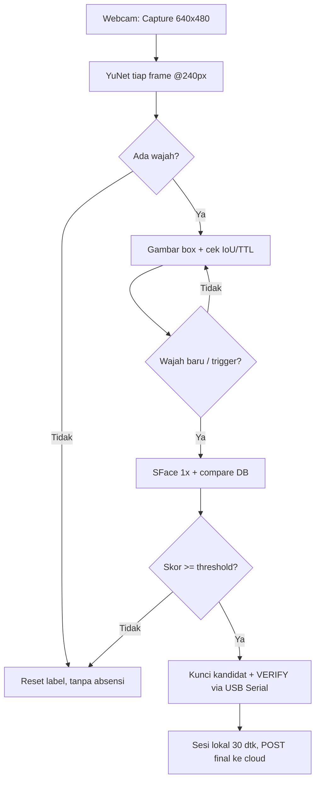
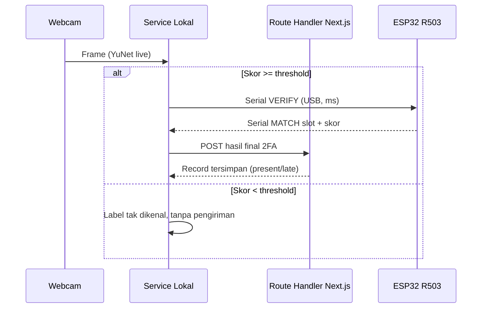

# Face Recognition — Pengenalan Wajah

> **Terverifikasi sebagian (2026-10-20)** — pola YuNet-live + SFace-on-demand sudah diuji di `apps/face-service/main.py` (Python 3.10, `opencv-contrib-python` 4.13, CPU). Bagian FastAPI/Route Handler masih rancangan.

## Tujuan

Face recognition adalah **faktor identifikasi pertama**: menentukan *siapa* siswa di depan webcam, sekali per kedatangan. Ia tidak mencatat absensi — hanya mengunci satu kandidat identitas, lalu sesi verifikasi fingerprint (30 detik) yang menentukan. Faktor kedua (fingerprint R503) memutus hasil akhir.

Dokumen terkait: [architecture.md](architecture.md), [backend.md](backend.md), [communication-flow.md](communication-flow.md).

## Keputusan Arsitektur (hasil uji 2026-10-20)

| Keputusan | Pilihan | Bukti uji |
|---|---|---|
| Pola inferensi | **YuNet tiap frame, SFace on-demand 1x** | InsightFace `FaceAnalysis` (4 model/frame @640px) patah-patah; SFace tiap 20 frame masih spike lag tiap bounding box muncul; SFace on-demand → feed mulus |
| Deteksi live | YuNet `2023mar` @ lebar 240px | Kotak stabil, 5–15 ms/frame di CPU |
| Verifikasi | SFace `2021dec`, cosine, threshold awal `0.40` | Kalibrasi genuine vs impostor menyusul |
| Bahasa/dependensi | `opencv-contrib-python` + `numpy` saja | Tanpa `onnxruntime`/`insightface`/`FastAPI` untuk tahap uji |
| Penyimpanan | `embeddings.npz` lokal PC kelas | Restart-safe (dibuktikan: DB terbaca ulang); tanpa foto, tanpa cloud |

Yang ditolak: `face_recognition`/dlib (build C++ gagal di Windows), MediaPipe (API asing, selisih hemat kecil), DeepFace (>1 GB).

## Teknologi

| Teknologi | Fungsi |
|---|---|
| Python 3.10+ (target 3.11) | Runtime service lokal |
| OpenCV contrib (modul DNN/Face) | YuNet deteksi + SFace embedding, CPU-only |
| YuNet | **Di mana wajahnya** — box + 5 landmark + skor, tiap frame |
| SFace | **Wajah siapa** — embedding 128-dimensi dari crop ter-align, hanya saat verifikasi/enrollment |
| FastAPI *(rencana)* | Membungkus pipeline menjadi API lokal (`/health`, `/recognize`, `/enroll`) |
| Model ONNX | `face_detection_yunet_2023mar.onnx` (~227 KB), `face_recognition_sface_2021dec.onnx` (~37 MB), di `apps/face-service/models/` (git-ignored) |

## Kebutuhan Perangkat dan Model

| Kebutuhan | Terverifikasi |
|---|---|
| Webcam 720p, cahaya depan | Ya — capture diset 640×480 agar decode cepat |
| CPU multi-core, RAM 8 GB | Ya — tanpa GPU |
| Model ONNX | Auto-download sekali via `urllib` saat start bila file belum ada |
| Penyimpanan embedding | `apps/face-service/embeddings_yunet.npz` — map nama → vektor float32 ter-normalisasi |

## Alur Enrollment Wajah Siswa

Terverifikasi di `main.py` (mode keyboard `e`):

1. Operator menekan `e` saat tepat satu wajah valid di frame (terbesar dipilih bila >1).
2. YuNet mendeteksi → SFace menghitung 1 embedding dari crop ter-align.
3. Embedding dirata-rata dengan sampel sebelumnya untuk nama yang sama, lalu dinormalisasi ulang (L2).
4. Disimpan ke `embeddings_yunet.npz`. Ulangi 3–5x dari sudut berbeda (lurus, kiri, kanan, mundur).
5. Versi FastAPI: `POST /enroll` dengan `student_id` + liste frame; `DELETE /enroll/{student_id}` menghapus barisnya (mis. siswa pindah).

## Alur Deteksi dari Frame Webcam

Pola on-demand (bukan tiap frame):

```
Webcam → Capture (640x480) → YuNet @240px tiap frame → gambar box (selalu mulus)
  → [trigger: wajah baru / tombol v / API] → SFace 1x → cosine vs DB lokal
  → Skor >= threshold → kunci kandidat → VERIFY serial ke ESP32 → POST hasil final ke Route Handler (sesi lokal 30 dtk)
  → Skor < threshold → "tak dikenal", tanpa pengiriman
```

Detail tahap:

1. **Capture** — 640×480, decode cepat.
2. **YuNet live** — deteksi di frame downscale 240px, box diskala balik ke penuh. Satu-satunya kerja tiap frame.
3. **Quality check** — tolak bila: tidak ada wajah, wajah terlalu kecil/blur, skor deteksi rendah.
4. **Trigger verifikasi** — SFace jalan 1x hanya saat: wajah baru masuk (IoU < 0.3 vs box sebelumnya), label kedaluwarsa, atau panggilan API. Tidak ada embedding periodik tanpa trigger.
5. **Compare** — cosine similarity vs seluruh embedding terdaftar, ambil tertinggi.
6. **Threshold check** — lolos → kandidat; gagal → "tak dikenal".
7. **Selesaikan 2FA lokal** — kandidat → `VERIFY` serial ke ESP32 via USB; hasil `MATCH`/`NO_MATCH`/`TIMEOUT` → 1 POST final ke Route Handler.

## Aturan Label / Anti-Stale (terverifikasi)

Bug yang ditemukan saat uji: label nama menempel global sehingga wajah berikutnya (mis. foto Elon) mewarisi nama sebelumnya. Aturan yang berlaku di `main.py` dan wajib di versi FastAPI:

1. **Wajah hilang dari frame → label langsung kosong.** Siswa berikutnya mulai dari tanpa nama.
2. **Ganti orang (IoU box < 0.3) → label kosong.** Posisi/ukuran melompat drastis = orang berbeda.
3. **Label kedaluwarsa (TTL 5 detik) → label kosong.** Butuh verifikasi ulang walau orang sama.

## Threshold dan Kalibrasi

- Threshold **MUST** dikalibrasi dari data nyata (skor genuine pemilik vs skor impostor), bukan default pustaka.
- Nilai awal `0.40`. Prosedur: catat skor diri sendiri vs skor orang lain/foto, pasang threshold di tengah (dugaan awal `0.50–0.55`, tunggu angka uji).
- Tinjau ulang tiap penambahan batch siswa baru.

## Penanganan Kasus Khusus

| Kasus | Penanganan |
|---|---|
| Skor < threshold | Tidak mengirim kandidat; log lokal; arahkan ke enrollment |
| Banyak wajah dalam frame | Proses wajah terbesar; antrean satu orang di depan kamera |
| Skor zona abu-abu | Minta ulangi capture atau lanjut fingerprint manual |
| Wajah terhalang (masker, tangan) | Tolak di quality check |
| Wajah belum enroll | Box polos tanpa nama (aturan anti-stale); bukan nama siswa lain |

## Penyelesaian 2FA Lokal + Pengiriman Hasil Final

Face service tidak mengirim kandidat mentah ke cloud. Ia memutus 2FA sendiri via USB Serial ke ESP32 (lihat [fingerprint.md](fingerprint.md)), lalu mengirim **1 hasil final** ke Route Handler:

`POST /api/attendance` (HTTPS, kredensial perangkat):

```json
{
  "device_id": "class-pc-01",
  "student_id": "STD-2024-001",
  "face_confidence": 0.71,
  "fingerprint_slot": 12,
  "fingerprint_score": 180,
  "captured_at": "2026-10-20T07:01:22+07:00"
}
```

Respons: record absensi tersimpan (`present`/`late`) atau ditolak (duplikat/aturan) — detail di [backend.md](backend.md).

## Endpoint Service Lokal

> `main.py` saat ini memakai keyboard (`v`/`e`/`c`/`q`). Tabel di bawah adalah kontrak FastAPI yang menggantikannya — **belum diimplementasikan**.

| Method & Path | Fungsi |
|---|---|
| `GET /health` | Status service + versi model + jumlah wajah terdaftar |
| `POST /recognize` | Satu frame → kandidat identitas (SFace 1x) |
| `POST /enroll` | Daftarkan/perbarui embedding siswa |
| `DELETE /enroll/{student_id}` | Hapus data wajah siswa |

Contoh `GET /health` → `200 OK`:

```json
{
  "status": "ok",
  "models": { "detector": "yunet_2023mar", "recognizer": "sface_2021dec" },
  "registered_faces": 1
}
```

Contoh `POST /recognize` request:

```json
{
  "image_base64": "<base64 JPEG>",
  "min_confidence": 0.5
}
```

Response cocok:

```json
{
  "faces_detected": 1,
  "match": true,
  "student_id": "S-2026-0042",
  "confidence": 0.71,
  "threshold_used": 0.5
}
```

Response tidak dikenal:

```json
{
  "faces_detected": 1,
  "match": false,
  "student_id": null,
  "confidence": 0.32,
  "threshold_used": 0.5,
  "reason": "below_threshold"
}
```

Contoh `POST /enroll`:

```json
{
  "student_id": "S-2026-0042",
  "images_base64": ["<base64>", "<base64>"]
}
```

```json
{
  "student_id": "S-2026-0042",
  "enrolled": true,
  "samples_used": 2
}
```

## Diagram Flowchart



## Sequence Diagram



## Penanganan Error dan Troubleshooting

| Gejala | Penyebab terverifikasi | Tindakan |
|---|---|---|
| `ValueError: truth value of array ambiguous` | `detector.detect` kembalikan ndarray; `if faces:` gagal | Kembalikan list baris (`[row for row in faces]`), cek `len()` — sudah diperbaiki |
| Gerakan patah saat box muncul | SFace jalan otomatis tiap N frame | Matikan embedding periodik; SFace hanya on-demand — sudah diperbaiki |
| Label nama menempel ke wajah lain | Label global tanpa reset | Terapkan 3 aturan anti-stale (hilang/IoU/TTL) — sudah diperbaiki |
| Selalu "tidak dikenal" | Threshold tinggi / belum enroll / cahaya buruk | Kalibrasi ulang, enroll 4 sudut, perbaiki cahaya |
| Model gagal dimuat | Path salah saat run dari folder lain | Path absolut ke `BASE_DIR` — sudah diperbaiki |
| `GET /health` gagal (nanti) | Service belum jalan / port salah | Cek proses, port, log startup |

## Privasi Data Biometrik dan Pengamanan Akses

- Simpan **embedding** (vektor), bukan foto. Foto hanya hidup di RAM sesaat.
- `embeddings.npz` + `models/*.onnx` di-gitignore — tidak pernah ke-commit.
- Service lokal **MUST NOT** diekspos ke internet; hanya localhost/LAN kelas.
- Kandidat ke Route Handler via HTTPS + kredensial perangkat (detail di [communication-flow.md](communication-flow.md)).
- Tidak ada endpoint yang membuang seluruh DB embedding.
- Hapus siswa = hapus baris embedding lokal + template R503 + nonaktifkan di Supabase.
