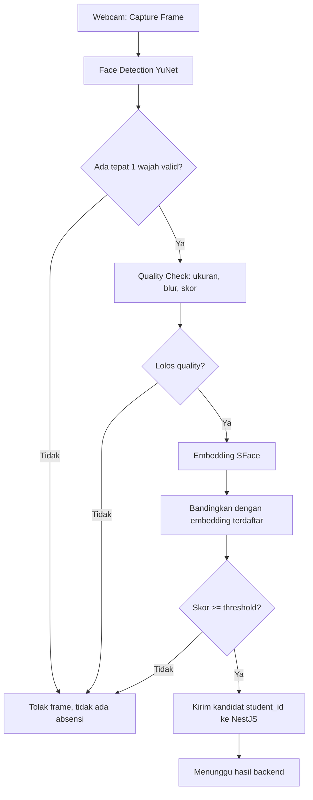
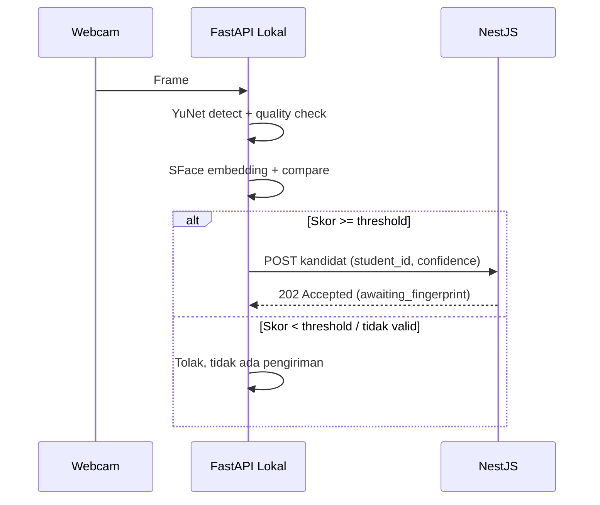

# Face Recognition — Pengenalan Wajah

> **Rancangan** — endpoint, threshold, dan contoh JSON di bawah adalah rancangan awal. Belum ada implementasi yang diverifikasi.

## Tujuan

Face recognition berfungsi sebagai **faktor identifikasi pertama**: menentukan *siapa* siswa yang berdiri di depan webcam sebelum verifikasi fingerprint. Ia tidak mencatat absensi sendiri — hanya mengirim kandidat identitas ke backend NestJS.

Dokumen terkait: [architecture.md](architecture.md), [backend.md](backend.md), [communication-flow.md](communication-flow.md).

## Teknologi

| Teknologi | Fungsi |
|---|---|
| Python 3.11 | Runtime service pengenalan wajah lokal |
| OpenCV (modul DNN / Face) | Framework vision; memuat model YuNet dan SFace |
| YuNet | **Deteksi wajah**: menemukan kotak wajah + landmark dalam frame |
| SFace | **Ekstraksi fitur & pencocokan**: mengubah crop wajah menjadi vektor embedding, membandingkan kemiripan (cosine similarity) |
| FastAPI | Menyajikan REST API lokal (`/health`, `/recognize`, `/enroll`, …) |
| Model ONNX | File model YuNet dan SFace yang dimuat OpenCV saat startup |

### Alasan Memilih Python 3.11

`TBD` — perlu konfirmasi. Alasan yang direncanakan: OpenCV Python mendukung YuNet/SFace secara stabil pada 3.11, ekosistem FastAPI/NumPy matang, dan kompatibel dengan komputer kelas berbasis CPU tanpa toolchain tambahan.

### Perbedaan YuNet vs SFace

- **YuNet** menjawab *"di mana wajahnya?"* — input frame, output kotak wajah + 5 landmark + skor kepercayaan deteksi.
- **SFace** menjawab *"wajah siapa?"* — input crop wajah yang sudah disejajarkan (align) memakai landmark, output vektor embedding (mis. 128-dimensi, nilai pasti `TBD` sesuai model). Dua embedding dibandingkan dengan cosine similarity untuk mendapat skor kemiripan.

### Fungsi OpenCV dan FastAPI

- **OpenCV**: memuat model ONNX, menjalankan inferensi YuNet dan SFace di CPU, pra-pemrosesan gambar (resize, align, normalisasi).
- **FastAPI**: membungkus pipeline di atas menjadi HTTP API lokal agar komputer kelas (atau operator enrollment) dapat memanggilnya; bukan untuk diakses publik dari internet.

## Kebutuhan Perangkat dan Model

| Kebutuhan | Rancangan awal |
|---|---|
| Webcam | Resolusi minimal `TBD` (rancangan: 720p), pencahayaan depan cukup |
| CPU / RAM | CPU modern multi-core, RAM `TBD` — target 100 siswa berbasis CPU |
| Model ONNX | `face_detection_yunet_*.onnx`, `face_recognition_sface_*.onnx` — versi pasti `TBD` |
| Penyimpanan embedding | File lokal / database kecil di komputer kelas — `TBD` (lihat Privasi) |

## Alur Enrollment Wajah Siswa

1. Operator memanggil `POST /enroll` dengan `student_id` dan satu atau beberapa foto/frame.
2. Service mendeteksi wajah dengan YuNet; jika tidak tepat satu wajah valid → tolak dengan pesan jelas.
3. Crop wajah disejajarkan memakai landmark, diekstrak embedding-nya dengan SFace.
4. Jika beberapa sampel diberikan, embedding dirata-rata / dipilih yang terbaik — `TBD`.
5. Embedding disimpan dan dipetakan ke `student_id`, menimpa data lama siswa tersebut bila ada.
6. `DELETE /enroll/{student_id}` menghapus data wajah siswa (mis. siswa pindah sekolah).

## Alur Deteksi dari Frame Webcam

Dasar flowchart (sesuai arsitektur yang direncanakan):

```
Webcam → Capture Frame → Face Detection (YuNet) → Face Quality/Validity Check
  → Face Embedding (SFace) → Compare With Registered Embeddings
  → Confidence/Threshold Check → Send Candidate Student ID to NestJS
  → Await Backend Result
```

Detail tiap tahap:

1. **Capture Frame** — ambil frame dari webcam (rancangan: 1–2 fps saat mode absensi, `TBD`).
2. **Face Detection (YuNet)** — dapatkan daftar wajah + skor deteksi.
3. **Face Quality/Validity Check** — tolak jika: tidak ada wajah, lebih dari satu wajah (`TBD`: tolak atau pilih terbesar), wajah terlalu kecil/blur/skor deteksi rendah.
4. **Face Embedding (SFace)** — align crop dengan landmark, hitung embedding.
5. **Compare** — hitung cosine similarity terhadap seluruh embedding terdaftar, ambil skor tertinggi.
6. **Confidence/Threshold Check** — jika skor ≥ threshold → kandidat valid; jika tidak → "tidak dikenal", tidak ada pengiriman ke backend.
7. **Send Candidate** — kirim `student_id` + skor ke NestJS, lalu tunggu hasil (absensi ditentukan backend setelah verifikasi fingerprint).

## Threshold dan Kalibrasi

- Threshold kemiripan (mis. cosine similarity) **MUST** dikalibrasi memakai data pengujian nyata (foto siswa dalam kondisi pencahayaan kelas), bukan nilai default pustaka.
- Nilai awal `TBD`. Prosedur rancangan: kumpulkan pasangan genuine/impostor, plot distribusi skor, pilih threshold dengan false-accept rate yang dapat diterima, tinjau ulang tiap penambahan siswa baru.
- Jangan mengarang angka benchmark di dokumen ini sebelum pengujian dilakukan.

## Penanganan Kasus Khusus

| Kasus | Penanganan (rancangan) |
|---|---|
| Wajah tidak dikenal (skor < threshold) | Tidak mengirim kandidat; log lokal; operator dapat mengarahkan siswa ke enrollment |
| Banyak wajah dalam frame | Tolak frame (`TBD`: atau proses wajah terbesar saja dengan flag peringatan) |
| Hasil tidak meyakinkan (skor di zona abu-abu) | Jangan buat absensi; minta ulangi capture atau lanjutkan ke fingerprint manual — `TBD` |
| Wajah terhalang (masker, tangan) | Ditolak pada quality check; minta siswa menghadap kamera tanpa penghalang |

## Pengiriman Kandidat ke NestJS

Contoh konseptual (HTTPS `POST` ke backend, endpoint pasti `TBD`):

```json
{
  "device_id": "class-pc-01",
  "student_id": "S-2026-0042",
  "confidence": 0.71,
  "captured_at": "2026-10-16T07:01:22+07:00"
}
```

Respons backend (rancangan): sesi verifikasi dibuat dengan status `awaiting_fingerprint` dan batas waktu — detail di [backend.md](backend.md).

## Endpoint Konseptual Service Lokal

> **Rancangan — Belum diimplementasikan.** Jangan menganggap endpoint ini sudah tersedia.

| Method & Path | Fungsi |
|---|---|
| `GET /health` | Status service + versi model yang dimuat |
| `POST /recognize` | Menerima frame/gambar, mengembalikan kandidat identitas |
| `POST /enroll` | Mendaftarkan/memperbarui embedding wajah siswa |
| `DELETE /enroll/{student_id}` | Menghapus data wajah siswa |

### Contoh `GET /health` → `200 OK`

```json
{
  "status": "ok",
  "models": { "detector": "yunet", "recognizer": "sface" },
  "model_versions": "TBD",
  "registered_faces": 0
}
```

### Contoh `POST /recognize` (request)

```json
{
  "image_base64": "<base64 JPEG, TBD batas ukuran>",
  "min_confidence": 0.6
}
```

### Contoh `POST /recognize` (response — wajah cocok)

```json
{
  "faces_detected": 1,
  "match": true,
  "student_id": "S-2026-0042",
  "confidence": 0.71,
  "threshold_used": 0.6
}
```

### Contoh `POST /recognize` (response — tidak dikenal)

```json
{
  "faces_detected": 1,
  "match": false,
  "student_id": null,
  "confidence": 0.32,
  "threshold_used": 0.6,
  "reason": "below_threshold"
}
```

### Contoh `POST /enroll` (request)

```json
{
  "student_id": "S-2026-0042",
  "images_base64": ["<base64>", "<base64>"]
}
```

### Contoh `POST /enroll` (response)

```json
{
  "student_id": "S-2026-0042",
  "enrolled": true,
  "samples_used": 2
}
```

## Diagram Flowchart



## Sequence Diagram (hingga backend menerima hasil)



## Penanganan Error dan Troubleshooting

| Gejala | Kemungkinan penyebab | Tindakan |
|---|---|---|
| `GET /health` gagal | Service belum jalan / port salah | Cek proses, port, log startup, path model ONNX |
| Model gagal dimuat | Path salah, versi OpenCV tidak cocok | Verifikasi path + versi OpenCV — `TBD` |
| Selalu "tidak dikenal" | Threshold terlalu tinggi / embedding belum terdaftar / pencahayaan buruk | Kalibrasi ulang threshold, ulangi enrollment, perbaiki pencahayaan |
| Lambat di CPU | Resolusi frame terlalu besar / fps terlalu tinggi | Turunkan resolusi & fps — nilai pasti `TBD` |
| Banyak wajah → tidak pernah absen | Penempatan kamera menangkap banyak siswa | Atur posisi kamera antrean satu orang |

## Privasi Data Biometrik dan Pengamanan Akses

- Simpan **embedding** (vektor matematis), bukan foto wajah mentah, kecuali foto diperlukan sementara untuk enrollment — kebijakan retensi `TBD`.
- Service FastAPI lokal **MUST NOT** diekspos ke internet publik; hanya didengar di localhost/LAN kelas dan dibatasi akses operator.
- Pengiriman kandidat ke NestJS memakai HTTPS + kredensial perangkat (detail di [communication-flow.md](communication-flow.md)).
- Akses baca embedding dibatasi untuk proses pencocokan; tidak ada endpoint yang membuang seluruh database embedding.
- Penghapusan data siswa (`DELETE /enroll/{student_id}`) harus menghapus embedding-nya; sinkronisasi penghapusan dengan backend `TBD`.
