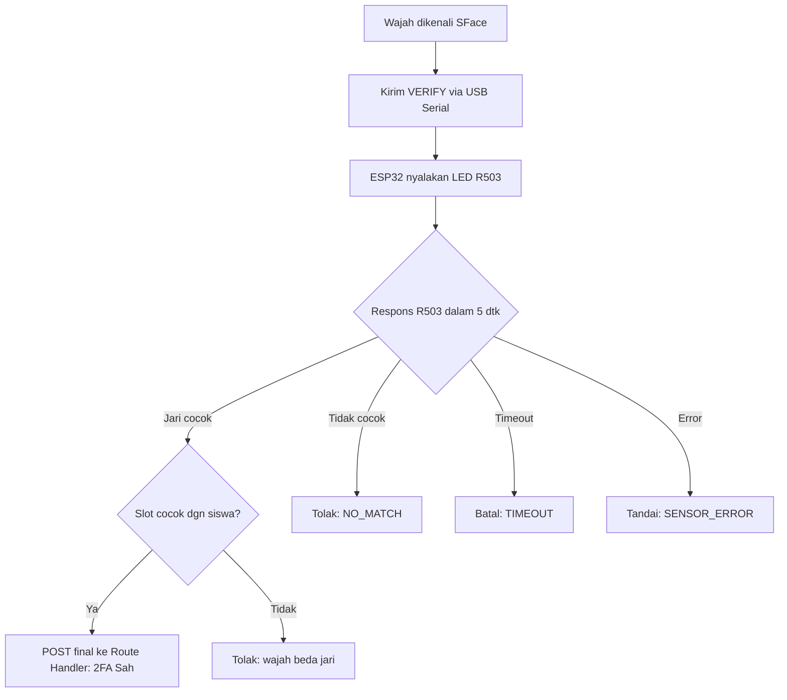

# Fingerprint — Verifikasi Sidik Jari (ESP32 + R503 via USB Serial)

> **Aktif (2026-10-20)** — ESP32 R503 terhubung ke laptop kelas via **kabel USB (Serial COM)**. Daya dari port USB, komunikasi milidetik tanpa Wi-Fi / cloud polling. Versi Wi-Fi polling lama diarsipkan di [`archive/wifi-polling/fingerprint.md`](archive/wifi-polling/fingerprint.md) sebagai cadangan bila kabel USB tidak sampai.

## Tujuan

Sensor fingerprint R503 pada ESP32 berfungsi sebagai **faktor verifikasi kedua**: memastikan siswa yang dikenali wajahnya adalah orang yang sama yang menempelkan jari. Tanpa kecocokan ini, absensi tidak dicatat.

Dokumen terkait: [architecture.md](architecture.md), [face-recognition.md](face-recognition.md), [communication-flow.md](communication-flow.md).

## Topologi Fisik

```
[ Laptop Kelas ]
   └── (Kabel USB — daya 5V + serial data 115200 baud)
        └── [ ESP32 DevKit ]
                 └── (Pin UART 16/17 + 3.3V/5V + GND)
                      └── [ Sensor R503 ]
```

- Daya: port USB laptop (500mA–1A) mencukupi kebutuhan ESP32 (~80mA) + R503 (~50mA). Tanpa adaptor dinding tambahan.
- Latensi: <10 ms pengiriman perintah serial vs 3–5 detik pada Wi-Fi polling.

## Teknologi

| Komponen | Fungsi |
|---|---|
| ESP32 | Mikrokontroler: baca USB Serial dari laptop, kendalikan R503 via UART, kembalikan hasil via Serial |
| Sensor R503 | Simpan template sidik jari, pencocokan 1:N lokal di dalam sensor, kembalikan ID template + skor |
| Driver PC | `pyserial` di `apps/face-service/fingerprint_serial.py` (belum dibuat, dibuat saat hardware ada) |

**Batasan penting:** R503 melakukan pencocokan **di dalam sensor** dan hanya mengembalikan ID template + skor, bukan citra sidik jari. Citra tidak pernah ditransmisikan.

## Protokol Komunikasi USB Serial (115200 baud)

Format berbasis teks baris (`\n` sebagai terminator):

| Dari | Ke | Perintah / Respons | Keterangan |
|---|---|---|---|
| PC | ESP32 | `VERIFY:<timeout_detik>` | Minta R503 menyalakan lampu ungu, tunggu jari ditempelkan (default 5 detik) |
| PC | ESP32 | `ENROLL:<slot_id>` | Minta siswa menempelkan jari 2x untuk slot tertentu |
| PC | ESP32 | `DELETE:<slot_id>` | Hapus template di slot tertentu |
| PC | ESP32 | `PING` | Tes koneksi |
| ESP32 | PC | `PONG` | Balasan tes koneksi |
| ESP32 | PC | `MATCH:<slot_id>:<score>` | Jari cocok; kembalikan slot numerik + skor |
| ESP32 | PC | `NO_MATCH` | Jari terbaca tapi tidak ada template cocok |
| ESP32 | PC | `TIMEOUT` | Tidak ada jari ditempelkan hingga batas waktu |
| ESP32 | PC | `ERROR:<kode>` | Sensor kotor / lepas / error komunikasi |

## Proses Enrollment Template

1. Operator menekan tombol enroll fingerprint di dashboard/PC untuk `student_id` tertentu (mis. slot N).
2. Face service mengirim `ENROLL:N` via USB Serial ke ESP32.
3. ESP32 menyalakan LED ungu R503, meminta siswa menempelkan jari 2x sesuai prosedur sensor.
4. ESP32 mengembalikan `ENROLLED:N` via serial ke face service.
5. Face service memperbarui `fingerprint_slot = N` dan `fingerprint_status = 'enrolled'` di Supabase via Route Handler.
6. Penghapusan siswa: `DELETE:N` via serial, lalu nonaktifkan di database.

## Alur Pencocokan Sidik Jari (Mode Absensi)

1. Face service mengenali wajah (YuNet live + SFace 1x, anti-stale: IoU + TTL), mengunci `student_id`.
2. Face service ambil `fingerprint_slot` milik `student_id` dari cache lokal / database.
3. Face service kirim `VERIFY:5` via USB Serial ke ESP32.
4. Sensor R503 menyala, siswa menempelkan jari (maksimal 5 detik).
5. ESP32 membaca jari, mencocokkan di ROM sensor, lalu kirim hasil via serial:
   - `MATCH:<slot>:<score>` → jika `<slot>` == slot milik siswa yang wajahnya terdeteksi → **2FA sah**.
   - `MATCH:<slot_beda>:<score>` → jari orang lain → **2FA gagal** (wajah ≠ jari).
   - `NO_MATCH` → jari tidak dikenal → **2FA gagal**.
   - `TIMEOUT` → siswa tidak menempelkan jari → **sesi batal**.
6. Face service mengirim 1 hasil final ke Route Handler (`POST /api/attendance`):
   ```json
   {
     "device_id": "class-pc-01",
     "student_id": "STD-2024-001",
     "face_confidence": 0.71,
     "fingerprint_slot": 12,
     "fingerprint_score": 180,
     "captured_at": "2026-10-20T07:01:22+07:00"
   }
   ```
7. Route Handler menyimpan ke tabel `attendance` Supabase; event Realtime diteruskan ke dashboard.

## Penanganan Kasus Khusus

| Kondisi | Penanganan |
|---|---|
| Template tidak cocok | ESP32 kirim `NO_MATCH`; face service batalkan sesi; siswa dapat ulangi |
| Timeout (siswa tidak tempel jari) | ESP32 kirim `TIMEOUT` setelah 5 detik; sesi dibatalkan |
| Wajah siswa A, tapi jari siswa B | Face service mendeteksi slot ≠ slot siswa A → tolak dengan log audit |
| Kabel USB terlepas | `pyserial` melempar `SerialException`; face service tandai status perangkat `offline` lokal; colok ulang → auto-reconnect |
| Sensor terputus / error hardware | ESP32 kirim `ERROR:SENSOR_DISCONNECTED`; face service tandai sensor error |

## Diagram Flowchart



## Keamanan dan Batasan

- Template sidik jari tidak pernah keluar dari sensor sebagai citra.
- Komunikasi serial hanya lewat kabel USB lokal di dalam ruangan kelas — tidak terpapar ke jaringan sekolah / internet.
- Tanpa tabel antrian cloud: tidak ada `device_commands` yang bisa di-intercept atau tersisa macet di database.
- Akses enrollment dibatasi untuk operator terautentikasi.

## Fallback ke Wi-Fi Polling

Bila di lokasi fisik kabel USB tidak sampai ke meja absensi, beralihlah ke firmware Wi-Fi polling di [`archive/wifi-polling/fingerprint.md`](archive/wifi-polling/fingerprint.md). Firmware ESP32 cukup diganti dari sketch Serial ke sketch HTTP polling; antarmuka ke R503 tetap sama.
