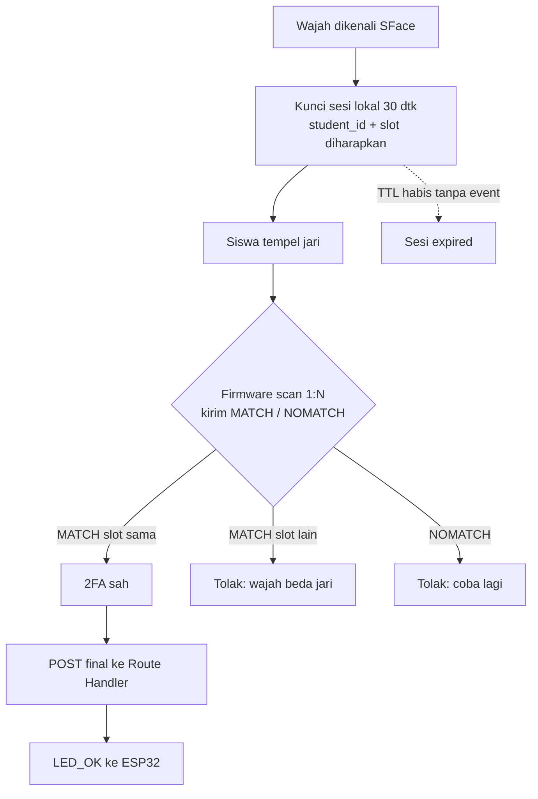
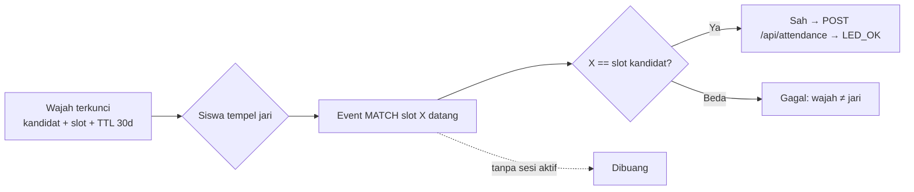

# Fingerprint — Verifikasi Sidik Jari (ESP32 + R503 via USB Serial)

> **Aktif (2026-10-20)** — ESP32 R503 terhubung ke laptop kelas via **kabel USB (Serial COM)**. Daya dari port USB, komunikasi milidetik tanpa Wi-Fi / cloud polling. Versi Wi-Fi polling lama diarsipkan di [`archive/wifi-polling/fingerprint.md`](archive/wifi-polling/fingerprint.md) sebagai cadangan bila kabel USB tidak sampai.
>
> **Sumber kebenaran protokol:** `esp32R503_Serial/esp32R503_Serial.ino` (firmware v1.0). Dokumen ini mengikuti firmware apa adanya, bukan rancangan awal.

## Tujuan

Sensor fingerprint R503 pada ESP32 berfungsi sebagai **faktor verifikasi kedua**: memastikan siswa yang dikenali wajahnya adalah orang yang sama yang menempelkan jari. Tanpa kecocokan ini, absensi tidak dicatat.

Dokumen terkait: [architecture.md](architecture.md), [face-recognition.md](face-recognition.md), [communication-flow.md](communication-flow.md).

## Topologi Fisik

```
[ Laptop Kelas ]
   └── (Kabel USB — daya 5V + serial data 115200 baud)
        └── [ ESP32 DevKit ]
                 └── (UART2: GPIO16 RX / GPIO17 TX, 57600 baud, 3.3V + GND)
                      └── [ Sensor R503 ]
```

- Daya: port USB laptop (500mA–1A) mencukupi kebutuhan ESP32 (~80mA) + R503 (~50mA).
- Dua jalur serial berbeda: **USB ke laptop 115200 baud**, **UART2 ke sensor 57600 baud**. Jangan tertukar.
- GPIO4 (`WAKEUP_PIN`) hanya di-`pinMode(INPUT)`, belum dipakai firmware.

## Teknologi

| Komponen | Fungsi |
|---|---|
| ESP32 | Baca perintah baris dari USB Serial, kendalikan R503 via UART2, kirim event hasil |
| Sensor R503 | Simpan template sidik jari, pencocokan 1:N lokal di dalam sensor, kembalikan ID slot + skor |
| Driver PC | `pyserial` di `apps/face-service/fingerprint_serial.py` (**belum dibuat**) |

**Batasan penting:** R503 melakukan pencocokan **di dalam sensor** dan hanya mengembalikan ID slot + skor, bukan citra sidik jari. Citra tidak pernah ditransmisikan. Kapasitas template: **slot 1..200**.

## Protokol USB Serial (115200 baud, teks per baris, terminator `\n`)

Pemisah argumen adalah **spasi**. Firmware mem-`trim()` tiap baris dan mengabaikan baris kosong.

### Perintah PC → ESP32

| Perintah | Respons | Keterangan |
|---|---|---|
| `PING` | `PONG <jumlah_template>` | Tes koneksi + hitung template tersimpan |
| `ENROLL <id>` | `ENROLLING <id>` … `ENROLL_OK <id> 0` / `ENROLL_FAIL <id> <kode>` | Rekam jari 2x ke slot `id` (1..200) |
| `DELETE <id>` | `DELETE_OK <id> 0` / `DELETE_FAIL <id> <kode>` | Hapus 1 slot |
| `CLEAR` | `CLEAR_OK 0` / `CLEAR_FAIL <kode>` | Hapus seluruh database sensor |
| `LED_OK` | `LED_DONE` | Kedip hijau 700 ms; dipakai setelah absensi tercatat |

Alias khusus Serial Monitor: `e` (enroll interaktif), `d <id>`, `c`, `m`. Perintah tak dikenal → `ERR_UNKNOWN <perintah>`.

### Event ESP32 → PC

| Event | Kapan |
|---|---|
| `BOOT <versi>` | Saat boot (sebelum sensor diperiksa) |
| `READY <jumlah_template>` | Handshake sensor sukses; LED biru bernapas |
| `SENSOR_FAIL 0` | `verifyPassword()` gagal — wiring 3.3V / TX-RX salah. Firmware **tidak** lock di `while(1)`, tetap menerima perintah |
| `ENROLLING <id>` | Enroll dimulai |
| `PLACE <id>` | Minta jari ditempel (dikirim 2x: sampel 1 dan 2) |
| `REMOVE` | Minta jari diangkat sebelum sampel kedua |
| `MATCH <id> <confidence>` | Jari cocok saat pemindaian bebas (1:N) |
| `NOMATCH` | Jari terbaca tetapi tidak cocok dengan slot mana pun |

### Yang TIDAK ada di firmware

- **Tidak ada perintah `VERIFY`.** Pemindaian berjalan terus-menerus di `loop()`: setiap kali ada jari menempel, firmware langsung `fingerSearch()` 1:N lalu mengirim `MATCH`/`NOMATCH`. Tidak ada timeout sesi, tidak ada target slot.
- **Tidak ada event `TIMEOUT` / `ERROR:<sebab>`.** Timeout 15 detik hanya berlaku internal di dalam `ENROLL`.
- **Tidak ada `DELETE_ALL` bernama lain** — gunakan `CLEAR`.

Konsekuensi desain: **gerbang sesi 2FA harus hidup di face service**, bukan di firmware. Face service yang menyimpan kandidat wajah + slot yang diharapkan + TTL, lalu mencocokkan event `MATCH` yang datang.

## Proses Enrollment Template

1. Operator menekan enroll fingerprint untuk `student_id` tertentu di halaman Students.
2. Face service menentukan slot kosong (atau slot lama milik siswa itu) dalam rentang 1..200.
3. Face service kirim `ENROLL <slot>` via USB Serial.
4. Balasan `ENROLLING <slot>` → UI masuk status menunggu.
5. `PLACE <slot>` → siswa tempel jari; `REMOVE` → angkat; `PLACE <slot>` → tempel ulang.
6. Sukses: `ENROLL_OK <slot> 0` → face service `PATCH /api/students/{id}` (`fingerprint_slot`, `fingerprint_status = 'enrolled'`).
7. Gagal: `ENROLL_FAIL <slot> <kode>` → UI tampilkan kode + tombol ulangi. Kode = kode error library `Adafruit_Fingerprint` (`FINGERPRINT_*`).
8. Hapus siswa / reset biometrik: `DELETE <slot>` → `DELETE_OK`, lalu kosongkan `fingerprint_slot`.

**Blocking:** selama `ENROLL`, `loop()` tertahan sampai `enrollFinger()` selesai (maks ±2×15 detik) sehingga perintah lain (termasuk `PING`) antre. Absensi tidak bisa berjalan bersamaan dengan enrollment — satu laptop, satu siswa.

## Alur Pencocokan Sidik Jari (Mode Absensi)

1. Face service mengenali wajah (YuNet live + SFace 1x, anti-stale: IoU + TTL) dan mengunci `student_id` + `fingerprint_slot` yang diharapkan untuk sesi 30 detik.
2. Firmware, tanpa diminta, terus memindai. Siswa menempelkan jari.
3. Firmware kirim `MATCH <slot> <confidence>` atau `NOMATCH`.
4. Face service mencocokkan event dengan sesi aktif:
   - `MATCH` dengan `<slot>` == slot siswa terkunci → **2FA sah**.
   - `MATCH` dengan slot lain → **2FA gagal** (wajah ≠ jari), catat audit.
   - `NOMATCH` → gagal, siswa boleh ulangi (sesi masih hidup sampai TTL).
   - Tidak ada event sampai TTL habis → sesi `expired`.
5. Setelah hasil final dikirim ke cloud dan tersimpan, face service kirim `LED_OK` → `LED_DONE` sebagai umpan balik hijau.
6. Face service mengirim 1 hasil final ke Route Handler (`POST /api/attendance`):
   ```json
   {
     "device_id": "class-pc-01",
     "student_id": "STD-2024-001",
     "face_confidence": 0.71,
     "fingerprint_slot": 12,
     "fingerprint_score": 180,
     "captured_at": "2026-10-20T07:01:22+07:00"
   }
   ```

**Risiko yang harus ditangani driver:** pemindaian bebas berarti jari siapa pun yang menempel kapan pun memicu `MATCH`. Bila tidak ada sesi aktif, event wajib **dibuang** (bukan dicatat sebagai absensi). Sebaliknya, `MATCH` yang tiba sebelum sesi dibuka (mis. jari sudah menempel duluan) harus diabaikan agar tidak terjadi pemasangan slot yang salah.

## Penanganan Kasus Khusus

| Kondisi | Penanganan |
|---|---|
| Template tidak cocok | `NOMATCH`; sesi tetap hidup sampai TTL; siswa ulangi |
| Tidak ada jari sampai TTL (30 dtk) | Face service tandai `expired`; tanpa pengiriman cloud |
| Wajah siswa A, jari siswa B | `MATCH` slot ≠ slot siswa A → tolak + log audit |
| Event `MATCH` tanpa sesi aktif | Buang (bukan absensi) |
| Slot belum terdaftar untuk siswa | Jangan buka sesi 2FA; arahkan ke enrollment dulu |
| Kabel USB terlepas | `pyserial` `SerialException` → status serial `disconnected`; auto-reconnect saat dicolok ulang |
| `SENSOR_FAIL 0` saat boot | Tandai sensor error; cek wiring 3.3V + TX/RX; ESP32 tetap menerima `PING` |
| Sensor error saat pindai (`getImage` ≠ OK) | Firmware diam (tidak kirim event); face service hanya melihat TTL habis |
| Enroll gagal di tengah | `ENROLL_FAIL <slot> <kode>`; slot tidak tersimpan; ulangi dari awal |

## Diagram Flowchart

### Alur Lengkap (Face + Fingerprint 2FA)



### Alur Sesi 2FA (Pencocokan Event Serial)

Rincian penanganan event serial per sesi yang disepakati pada diskusi:



## Keamanan dan Batasan

- Template sidik jari tidak pernah keluar dari sensor sebagai citra.
- Komunikasi serial hanya lewat kabel USB lokal di dalam ruangan kelas — tidak terpapar ke jaringan sekolah / internet.
- Tanpa tabel antrian cloud: tidak ada `device_commands` yang bisa di-intercept atau tersisa macet di database.
- Akses enrollment dibatasi untuk operator terautentikasi; `CLEAR` bersifat destruktif dan wajib konfirmasi ganda.
- Pemindaian bebas berarti sensor menerima jari siapa pun yang menempel; keputusan menerima/menolak **selalu** di face service + Route Handler, bukan di firmware.

## Fallback ke Wi-Fi Polling

Bila di lokasi fisik kabel USB tidak sampai ke meja absensi, beralihlah ke firmware Wi-Fi polling di [`archive/wifi-polling/fingerprint.md`](archive/wifi-polling/fingerprint.md). Firmware ESP32 cukup diganti dari sketch Serial ke sketch HTTP polling; antarmuka ke R503 tetap sama.
