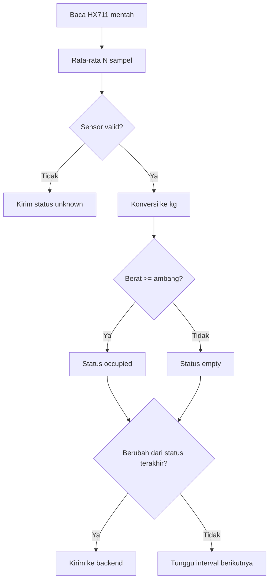

# IoT Monitoring — Status Kursi (Load Cell + HX711)

> **Rancangan** — nilai kalibrasi, ambang batas, dan format payload adalah rancangan awal. Belum ada firmware yang diverifikasi.

## Tujuan

Subsistem ini memantau **okupansi fisik kursi** (apakah kursi sedang diduduki) sebagai informasi pendukung kehadiran, bukan sebagai pengganti absensi biometrik.

Dokumen terkait: [architecture.md](architecture.md), [backend.md](backend.md), [database.md](database.md), [communication-flow.md](communication-flow.md).

## Teknologi

| Komponen | Fungsi |
|---|---|
| Load cell | Sensor regangan yang mengubah beban mekanis menjadi sinyal listrik kecil |
| HX711 | Modul ADC penguat: membaca sinyal load cell, menyediakan data digital ke ESP32 |
| ESP32 kursi | Membaca HX711, melakukan tare/kalibrasi, menentukan status kursi, mengirim ke backend |

## Pembacaan Beban Kursi

1. HX711 membaca nilai mentah (raw units) dari load cell secara berkala (interval `TBD`, rancangan: tiap beberapa detik).
2. ESP32 menerapkan faktor kalibrasi untuk mengonversi nilai mentah menjadi satuan berat (kg).
3. Untuk mengurangi noise, beberapa sampel dirata-rata (moving average, jumlah sampel `TBD`).
4. Berat hasil dibandingkan dengan ambang batas untuk menentukan status kursi.

## Kalibrasi dan Ambang Batas

- **Tare (nol)**: saat kursi kosong, ESP32 menetapkan titik nol. Prosedur: otomatis saat startup + perintah tare manual dari backend — `TBD`.
- **Faktor kalibrasi**: ditentukan dengan beban acuan yang diketahui (mis. beban standar `TBD` kg); tiap kursi dapat memiliki faktor berbeda.
- **Ambang batas** (rancangan, `TBD` setelah pengujian): mis. `< 5 kg` → `empty`, `≥ 5 kg` → `occupied`. Nilai pasti harus dikalibrasi per kursi karena perbedaan mekanis.
- Kalibrasi ulang diperlukan bila pembacaan melayang (drift) atau setelah perangkat dipindah.

## Konversi Status Kursi

| Kondisi (rancangan) | Status |
|---|---|
| Berat < ambang | `empty` (kosong) |
| Berat ≥ ambang | `occupied` (terisi) |
| Sensor tidak merespons / nilai tidak wajar | `unknown` (tidak diketahui) |

Hanya perubahan status (atau heartbeat berkala — `TBD`) yang dikirim ke backend untuk menghemat bandwidth.

Contoh payload (konseptual, `TBD`):

```json
{
  "device_id": "esp32-seat-03",
  "seat_id": "XII-IPA-1-14",
  "status": "occupied",
  "weight_kg": 42.5,
  "read_at": "2026-10-16T07:05:00+07:00"
}
```

## Diagram Flowchart



## Penanganan Pembacaan Tidak Stabil, Terputus, dan Offline

| Kondisi | Penanganan (rancangan) |
|---|---|
| Pembacaan berfluktuasi di sekitar ambang | Histeresis / debounce waktu (`TBD` detik) sebelum status dinyatakan berubah |
| Nilai mentah tidak wajar (negatif ekstrem, jenuh) | Tandai `unknown`; catat untuk inspeksi hardware |
| HX711 / load cell terputus | ESP32 melaporkan `unknown` + flag `sensor_error`; dashboard menandai perangkat |
| ESP32 offline | Data terakhir dianggap basi setelah `TBD`; dashboard menampilkan "data lama" |
| Beban permanen non-manusia (tas) | Tidak dapat dibedakan oleh sensor; lihat peringatan di bawah |

## Status Kursi vs Status Kehadiran

> Kursi kosong **MUST NOT** disimpulkan sebagai siswa tidak hadir, dan kursi terisi **MUST NOT** disimpulkan sebagai kehadiran valid.

Alasannya: tas di atas kursi terbaca "terisi"; siswa hadir tetapi berdiri/berpindah kursi terbaca "kosong". Status kursi hanya **pendukung**: dikorelasikan dengan catatan absensi + aturan waktu (mis. kursi terisi selama jam pelajaran memperkuat keyakinan kehadiran — aturan pasti `TBD`). Absensi resmi selalu berasal dari verifikasi wajah + fingerprint di [backend.md](backend.md).
