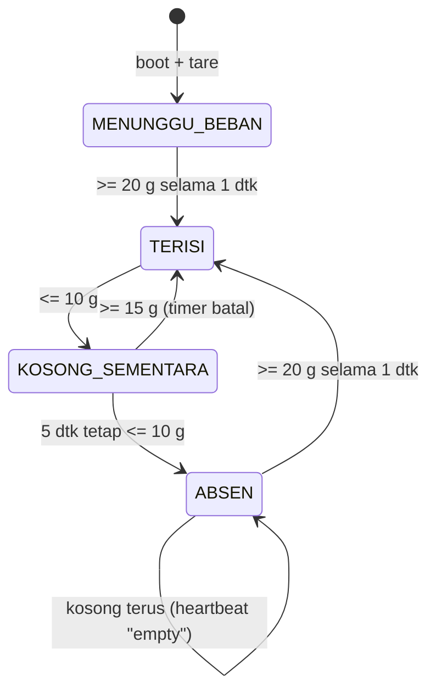

# Firmware Kursi — `esp32Loadcell_WiFi.ino`

Sensor okupansi kursi: **HX711 + load cell** → Wi-Fi → Route Handler Next.js → Supabase.

```
Load cell ──HX711──> ESP32 ──Wi-Fi HTTP POST──> /api/seats/status (Next.js) ──> seat_status + seat_events + devices
```

Firmware **menentukan status** (`occupied` / `empty` / `unknown`) dengan histeresis. Backend tidak menghitung ulang: ia memvalidasi, menyimpan, dan menulis heartbeat. Lihat [iot-monitoring.md](../ObsidianAllProgramSK/docs/iot-monitoring.md) untuk batasan konsepnya (kursi terisi ≠ hadir) dan [gerbang-ino-database.md](../ObsidianAllProgramSK/docs/gerbang-ino-database.md) untuk rantai kode sampai tabel Supabase.

---

## 1. Peta Bagian Kode

| Baris | Bagian | Isi |
|---|---|---|
| 1–8 | Header komentar | Kontrak singkat: endpoint, pin, library, syarat `devices`/`seats` |
| 9–14 | Include | `WiFi`, `WiFiClientSecure`, `HTTPClient`, `HX711` |
| 16–31 | **Konfigurasi** | `API_URL`, `DEVICE_ID`, `SEAT_ID`, `FIRMWARE_VERSION`, timeout & interval |
| 33–52 | **Hardware & ambang** | Pin HX711, faktor kalibrasi, deadband nol, ambang histeresis, timer |
| 54–70 | **State** | `SeatState`, timer, buffer kirim tertunda (`dirty` / `pending*`), backoff |
| 72–80 | `stateText()` | Nama status untuk log Serial |
| 82–86 | `readWeightGrams()` | Rata-rata 5 sampel + paksa nol bila ≤ deadband |
| 88–92 | `markDirty()` | Tandai ada status baru untuk dikirim |
| 94–101 | `ensureWifi()` | Sambung ulang Wi-Fi tiap 10 dtk bila putus |
| 103–141 | `postStatus()` | Bangun JSON, pilih HTTPS/HTTP, POST, kembalikan `code == 200` |
| 143–156 | `flushPending()` | Kirim bila `dirty`; gagal → backoff 2→4→…→30 dtk |
| 158–199 | `updateSeatState()` | Mesin status 4 fase (diagram di §4) |
| 201–233 | `setup()` | Wi-Fi, `loadCell.begin`, `set_scale`, `tare(20)`, lapor `empty` |
| 235–270 | `loop()` | Baca berat → update status → heartbeat → flush → cetak Serial |

---

## 2. Pin & Hardware

| Sinyal | GPIO | Catatan |
|---|---|---|
| HX711 `DOUT` | 19 | Data keluar modul ADC |
| HX711 `SCK` | 18 | Clock ke HX711 |
| HX711 `VCC` | 3V3 / 5V | Ikuti modul: board HX711 umumnya diberi 5V; pin `DT`/`SCK` tetap 3.3V logic-safe. Jangan beri 5V ke pin GPIO ESP32 |
| HX711 `GND` | GND | Harus satu ground dengan ESP32 |

Library Arduino: **`HX711` (bogde)**.

---

## 3. Konfigurasi yang Wajib Disesuaikan (`:16–25`)

```cpp
const char *API_URL = "http://192.168.1.6:3000/api/seats/status";
const char *DEVICE_ID = "SEAT-ESP-01";
const char *SEAT_ID   = "SEAT-01";
```

1. **`API_URL`** — IP LAN laptop (dev) atau host Next.js (produksi). IP berubah setiap pindah jaringan; cek `ipconfig` sebelum flash. Mode `http://` memakai `WiFiClient` biasa; `https://` memakai `WiFiClientSecure` dengan `setInsecure()` (prototipe, tidak verifikasi sertifikat — produksi: `secure.setCACert(...)` di `:125`).
2. **`DEVICE_ID`** — **harus ada** di tabel `devices` dengan `type = 'seat_esp32'` dan `is_active = true`. Kalau tidak, Route Handler menjawab `404` / `403` (lihat §6).
3. **`SEAT_ID`** — harus ada di tabel `seats` **dan** `seats.device_id` harus sama dengan `DEVICE_ID`. Salah pasang → `409 Conflict`.
4. **Wi-Fi** — `secrets.h` (di-ignore git). Salin dari `secrets.h.example`, isi `WIFI_SSID` / `WIFI_PASS`.

**Tidak disimpan di firmware:** kunci Supabase. Kredensial database hanya hidup di server Next.js.

---

## 4. Mesin Status (`updateSeatState`, `:158–199`)

Ambang prototipe (beban uji 30 gram, **bukan** ambang manusia) di `:46–48`:

| Konstanta | Nilai | Fungsi |
|---|---|---|
| `OCCUPIED_THRESHOLD_G` | 20 g | Naik dari kosong → terisi |
| `EMPTY_THRESHOLD_G` | 10 g | Turun dari terisi → hitung kosong |
| `RECOVERY_THRESHOLD_G` | 15 g | Batalkan hitungan kosong (histeresis) |
| `OCCUPIED_CONFIRM_MS` | 1000 ms | Beban harus bertahan sebelum dinyatakan terisi |
| `ABSENCE_DELAY_MS` | 5000 ms | Beban hilang selama ini → `empty` |

Rentang 10–20 g sengaja "netral": status terakhir dipertahankan agar noise tidak memicu status bolak-balik.



Nama fase di kode: `WAITING_FOR_LOAD` → `OCCUPIED` → `EMPTY_PENDING` → `ABSENT`.

Yang dikirim ke backend:

| Transisi | `status` | `weight_kg` |
|---|---|---|
| `setup()` setelah tare | `empty` | 0 |
| Masuk `OCCUPIED` | `occupied` | berat gram / 1000 |
| Masuk `ABSENT` | `empty` | berat gram / 1000 |
| HX711 tidak siap (`:239–244`) | `unknown` | tidak dikirim |
| Heartbeat 20 dtk (`:252–254`) | status terakhir | berat terakhir |

---

## 5. Alur Kirim & Anti-Kehilangan Data (`flushPending`, `:143–156`)

- Status baru hanya **ditandai** (`markDirty`). Pengiriman dilakukan di `loop()`, jadi pembacaan sensor tidak pernah diblokir HTTP.
- Buffer hanya menyimpan **status terbaru**; status lama yang belum terkirim boleh hilang (yang penting kondisi fisik terkini).
- Gagal kirim → `retryDelay` berlipat 2 (2000 → 4000 → … → maksimum 30000 ms). Sukses → reset ke 2000 ms.
- Wi-Fi putus → `ensureWifi()` menyambung ulang tiap 10 dtk; data tetap di buffer sampai berhasil.
- Sukses (`200`) → `lastHeartbeat = now`, jadi timer heartbeat ikut ter-reset.

Heartbeat 20 dtk (`HEARTBEAT_MS`) ada supaya `devices.last_seen_at` tetap segar walau kursi tidak berubah status; tanpa itu Overview menandai perangkat offline setelah `app_config.device_offline_seconds` (default 60 dtk).

---

## 6. Kontrak HTTP ke Backend

`POST /api/seats/status` — payload dari `postStatus()` (`:106–117`):

```json
{
  "device_id": "SEAT-ESP-01",
  "seat_id": "SEAT-01",
  "status": "occupied",
  "weight_kg": 0.312,
  "firmware_version": "1.0.0"
}
```

`weight_kg` dihilangkan saat status `unknown` (berat `NaN`).

Respons yang mungkin:

| Kode | Arti | Tindakan di firmware |
|---|---|---|
| `200` | Tersimpan | reset backoff, `dirty = false` |
| `400` | Field kurang / status tidak valid | ulangi terus (bug firmware — perbaiki kode) |
| `404` | `device_id` / `seat_id` tidak terdaftar | ulangi terus; daftarkan perangkat di DB |
| `403` | Perangkat nonaktif atau bukan `seat_esp32` | ulangi terus; cek `devices.is_active` / `type` |
| `409` | Kursi ter-assign ke perangkat lain | ulangi terus; perbaiki `seats.device_id` |
| `<= 0` | Gagal jaringan / timeout 6 dtk | backoff |

Firmware tidak membedakan `4xx` dan jaringan — semuanya "gagal, coba lagi". Pesan terakhir terlihat di Serial Monitor: `POST occupied -> 200 {...}`.

---

## 7. Kalibrasi (`:39–41`, `:221–229`)

1. `setup()` menunggu HX711 siap, lalu `tare(20)` — **kursi harus kosong saat boot**, kalau tidak titik nol salah.
2. `CALIBRATION_FACTOR = 1109.4f` berasal dari data uji: `(853728 - 660691) / 174 ≈ 1109.4` (raw unit per gram).
3. Kalibrasi ulang: kurangi raw kosong dari raw berbeban, bagi dengan berat acuan (gram) → ganti `CALIBRATION_FACTOR`.
4. Bila berat terbaca negatif saat dibebani, balik tandanya jadi `-1109.4`.
5. `ZERO_DEADBAND_G = 3.0` membuat sisa noise (−2.2 g) tampil sebagai 0 g.

---

## 8. Flashing & Verifikasi

1. Arduino IDE → board **ESP32 Dev Module**, pasang library `HX711` (bogde).
2. Salin `secrets.h.example` → `secrets.h`, isi Wi-Fi.
3. Set `API_URL` ke IP laptop (`ipconfig`).
4. Jalankan backend: `cd apps/web && npm run dev` (port 3000).
5. Pastikan baris DB ada:
   - `devices`: `device_id='SEAT-ESP-01'`, `type='seat_esp32'`, `is_active=true`
   - `seats`: `seat_id='SEAT-01'`, `device_id='SEAT-ESP-01'`
6. Flash, buka Serial Monitor **115200 baud**. Yang harus terlihat:

```
=== LOAD CELL KURSI -> Wi-Fi ===
Wi-Fi: menyambung.... OK 192.168.1.x
Tare selesai.
Berat: 0.0 g | Status: MENUNGGU BEBAN PERTAMA
POST empty -> 200 {"seat_id":"SEAT-01",...}
EVENT: kursi terisi.
POST occupied -> 200 {...}
```

7. Cek UI: halaman **Classes & Seats** (`/classes-seats`) menampilkan kursi berubah status ≤ 20 dtk (heartbeat).

---

## 9. Troubleshooting

| Gejala | Penyebab umum |
|---|---|
| `HX711 belum terbaca. Periksa VCC, GND, DT, SCK.` | Kabel DOUT/SCK tertukar, modul tidak dapat daya |
| Berat selalu 0 | Faktor kalibrasi terlalu besar/kecil; `tare` dilakukan saat kursi dibebani |
| Berat negatif | Tanda `CALIBRATION_FACTOR` salah |
| `POST ... -> 404` | `DEVICE_ID` / `SEAT_ID` belum ada di DB |
| `POST ... -> 409` | `seats.device_id` menunjuk perangkat lain |
| `POST ... -> -1` / `-11` | Timeout / tidak bisa connect: IP `API_URL` salah, laptop beda jaringan, firewall memblok port 3000 |
| Status bolak-balik di sekitar 10–20 g | Noise di rentang histeresis — naikkan `ZERO_DEADBAND_G` atau bobot beban uji |
| Kursi kosong tapi status `occupied` | Beban permanen (tas) — sensor tidak bisa membedakan, lihat peringatan di `iot-monitoring.md` |
