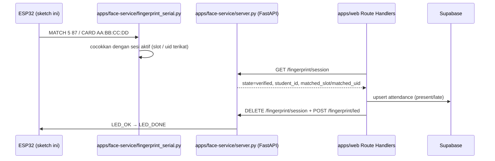

# Firmware Kios — `esp32R503_Serial.ino`

Jembatan **USB Serial** antara kios laptop dan sensor sidik jari **R503** (+ reader **RC522**, + LCD I2C 16x2).

```
Laptop (apps/face-service, Python) ──USB 115200──> ESP32 ──UART2 57600──> R503
                                                       ├──SPI──> RC522 (kartu RFID)
                                                       └──I2C──> LCD 16x2
```

Firmware ini **tidak** membuka Wi-Fi dan **tidak** menyentuh database. Ia hanya juru bicara perangkat keras: laptop mengirim perintah baris, firmware menjawab dengan baris. Kebijakan (sesi 2FA, slot siapa, kartu siapa, kapan absensi ditulis) seluruhnya di laptop/server.

## 1. Peta Bagian Kode

| Baris | Bagian | Isi |
|---|---|---|
| 1–28 | Header komentar | Daftar lengkap perintah masuk & event keluar (kontrak protokol) |
| 30–44 | Include & versi | `Adafruit_Fingerprint`, `MFRC522`, `LiquidCrystal_I2C`; `FW_VERSION "1.2"`; alamat & pin I2C |
| 46–58 | LCD helper | `lcdTulis()` (satu-satunya penulis LCD), `lcdSiap()` |
| 60–84 | Pin & objek | UART2 16/17, wakeup 4, SPI RC522 5/27, state jendela kartu |
| 86–92 | LED helper | `ledBiru` siaga, `ledHijau` sukses, `ledMerah` gagal, `ledMati` |
| 94–106 | Utilitas serial | `kirim()` + `Serial.flush()`, `kirimKode()` |
| 108–128 | Baca jari | `tungguJari()` (timeout 15 dtk), `tungguJariAngkat()` |
| 130–177 | `enrollFinger()` | 2 kali tempel → `createModel()` → `storeModel(id)` |
| 179–210 | `verifikasi()` | 1:N `fingerSearch()` → `MATCH id conf` / `NOMATCH` |
| 212–245 | `cekKartu()` | Non-blocking RC522, debounce 2 dtk, `CARD_OK` / `CARD` |
| 247–343 | `prosesPerintah()` | Parser perintah baris dari laptop |
| 345–386 | `setup()` | Serial, UART2, LCD, `verifyPassword()`, RC522, lapor `BOOT`/`READY` |
| 388–419 | `loop()` | Prioritas: perintah → timeout kartu → cek kartu → verifikasi jari |

> Peta lengkap kedua rantai firmware → database: [gerbang-ino-database.md](../ObsidianAllProgramSK/docs/gerbang-ino-database.md). Sisi Python yang memegang port COM: [python.md](python.md). Rantai penuh & sisi Next.js: [code-komunikasi-r503.md](../ObsidianAllProgramSK/docs/code-komunikasi-r503.md), [code-attendance-routes.md](../ObsidianAllProgramSK/docs/code-attendance-routes.md).

## 2. Pin & Wiring

| Sinyal | GPIO | Keterangan |
|---|---|---|
| UART2 RX | 16 | ← kabel **kuning** (TX R503) |
| UART2 TX | 17 | → kabel **hijau** (RX R503) |
| Wakeup | 4 | kabel **biru** (opsional) |
| RC522 SDA/SS | 5 | SPI |
| RC522 RST | 27 | SPI |
| RC522 SCK/MISO/MOSI | 18 / 19 / 23 | default SPI ESP32 |
| LCD SDA / SCL | 21 / 22 | I2C, alamat `0x27` (`0x3F` bila hanya backlight) |

Library: `Adafruit_Fingerprint`, `MFRC522`, `LiquidCrystal I2C` (Frank de Brabander).

Pin 16/17 sengaja dipakai UART2 agar tidak bertabrakan dengan SPI (18/19/23) maupun SS/RST (5/27); jangan pindahkan ke 16/17 lagi kalau reader diganti modul SPI lain.

---

## 3. Protokol Baris (kontrak utama)

Baud **115200**, satu baris = satu pesan, dipisah `\n`.

### Perintah laptop → ESP32 (parser `:247–343`)

| Perintah | Balasan | Arti |
|---|---|---|
| `PING` / `m` | `PONG <jumlah_template>` | Cek koneksi + jumlah template tersimpan |
| `ENROLL <id>` | `ENROLLING <id>` → `PLACE` / `REMOVE` → `ENROLL_OK <id> 0` atau `ENROLL_FAIL <id> <kode>` | Rekam 2 sampel ke slot 1..200 |
| `DELETE <id>` / `d <id>` | `DELETE_OK <id> 0` / `DELETE_FAIL <id> <kode>` | Hapus 1 slot |
| `CLEAR` / `c` | `CLEAR_OK 0` / `CLEAR_FAIL <kode>` | Hapus seluruh template di flash R503 |
| `LED_OK` | `LED_DONE` | Kedip hijau + LCD "Absensi tercatat"; dipakai setelah absensi tersimpan |
| `CARD` | `CARDWAIT` lalu `CARD_OK <UID>` / `CARD_TIMEOUT` | Buka jendela tempel kartu 15 dtk |
| `CANCEL` | `CARD_TIMEOUT` (bila jendela terbuka) | Batalkan jendela kartu |
| `LCD <b1>\|<b2>` | — | Tulis teks bebas ke LCD 16×2 |
| `e` | interaktif | Hanya untuk Serial Monitor manual; tanya ID lalu enroll |

Perintah tak dikenal → `ERR_UNKNOWN <perintah>`. ID di luar 1..200 langsung `ENROLL_FAIL` / `DELETE_FAIL` dengan kode `255`.

### Event ESP32 → laptop

| Event | Kapan |
|---|---|
| `BOOT <versi>` | Setelah `setup()` mulai (firmware hidup) |
| `READY <jumlah_template> [RFID <nama>]` | Sensor lolos `verifyPassword()` |
| `SENSOR_FAIL 0` | R503 tidak merespons (kabel TX/RX tertukar, daya) |
| `RFID_FAIL 0` | RC522 tidak terdeteksi; firmware tetap jalan tanpa kartu |
| `MATCH <id> <confidence>` | Jari cocok dengan slot `<id>` (pencarian 1:N di DSP sensor) |
| `NOMATCH` | Jari tidak dikenali; dikirim segera agar laptop tidak menunggu timeout |
| `CARD <UID>` | Kartu ditempel **di luar** jendela daftar → dipakai sesi 2FA yang aktif |
| `CARD_OK <UID>` | Kartu ditempel **di dalam** jendela `CARD` → hasil pendaftaran |
| `CARD_TIMEOUT` | 15 dtk habis tanpa kartu |
| `PLACE <id>` / `REMOVE` | Instruksi UI saat enroll sampel 1/2 |

UID diformat `AA:BB:CC:DD` huruf besar. Kartu yang sama tidak dikirim ulang dalam 2 dtk (`:233`) supaya kartu yang menempel lama tidak membanjiri serial.

---

## 4. Alur Kerja

### Enroll (`enrollFinger`, `:130–177`)

1. `PLACE <id>` → user tempel jari → `image2Tz(1)` (CharBuffer1).
2. `REMOVE` → user angkat jari → `tungguJariAngkat()`.
3. `PLACE <id>` lagi → user tempel jari sama → `image2Tz(2)`.
4. `createModel()` menggabungkan kedua sampel; gagal berarti dua tempelan beda jari/kualitas buruk.
5. `storeModel(id)` menyimpan permanen di flash R503 pada slot `id`.

Setiap kegagalan mengirim `ENROLL_FAIL <id> <kode>` dan mengedipkan LED merah 3× — kode adalah `uint8_t` dari library Adafruit (mis. `2` = tidak ada jari, `6` = gambar buram).

### Verifikasi (`verifikasi`, `:179–210`)

Dipanggil tiap `loop()` dan **non-blocking**: keluar seketika bila tidak ada jari.

- Ada jari → `image2Tz()` → `fingerSearch()` (1:N ke seluruh 200 slot di chip sensor).
- Cocok → `MATCH <slot> <confidence>`, LED hijau, LCD `Sidik jari OK`.
- Tidak cocok → `NOMATCH`, LED merah.
- Selalu `tungguJariAngkat()` + 300 ms sebelum bisa memindai lagi, agar satu tempelan tidak terbaca berkali-kali.

Firmware **tidak tahu** jari itu milik siswa mana. Pemetaan slot → siswa dan aturan "hanya hitung kalau sesi 2FA aktif" ada di laptop (§6).

### Kartu RFID (`cekKartu`, `:212–245`)

- `PICC_IsNewCardPresent()` + `PICC_ReadCardSerial()` tiap loop; `PICC_HaltA()` setelah baca supaya pembacaan berikutnya segar.
- Jendela `CARD` terbuka → kartu pertama mengisi jendela (`CARD_OK`), jendela langsung ditutup.
- Jendela tertutup → event `CARD <UID>` diteruskan; laptop yang memutuskan apakah UID itu milik siswa di sesi aktif.
- Hitung mundur sisa detik ditampilkan di LCD hanya saat angkanya berubah (`:402–410`).

### Loop (`:388–419`)

Urutan prioritas tiap iterasi (jeda 50 ms):

1. Ada baris masuk dari laptop → `prosesPerintah()`, `return` (perintah bisa memblokir: enroll hingga ~40 dtk).
2. Jendela kartu lewat waktu → `CARD_TIMEOUT`, LCD kembali siaga.
3. `cekKartu()` — non-blocking.
4. `verifikasi()` — non-blocking.
5. `delay(50)` agar UART tidak jenuh (~20 cek/detik).

---

## 5. `setup()` (`:345–386`)

1. `Serial.begin(115200)` + `fpSerial.begin(57600, SERIAL_8N1, 16, 17)`.
2. LCD dinyalakan **lebih dulu** supaya proses boot terlihat di layar fisik.
3. `kirim("BOOT 1.2")`.
4. `finger.begin(57600)` lalu `verifyPassword()`:
   - gagal → `SENSOR_FAIL 0`, LCD "Sensor R503 / Tidak terdeteksi", `return` (sengaja **tidak** `while(1)`) agar board tetap bisa didiagnosis lewat Serial Monitor;
   - sukses → `READY <n>`.
5. `SPI.begin()` + `rfid.PCD_Init()`; versi register `0x00`/`0xFF` = reader tidak ada → `RFID_FAIL 0`, LCD "Tanpa kartu".
6. LED biru bernapas = siaga.

---

## 6. Gerbang ke Database (sisi laptop & cloud)

Firmware ini **hanya** berbicara serial. Rantai dari ESP32 sampai baris `attendance`:



| Lapisan | File | Peran |
|---|---|---|
| Pembaca serial | `apps/face-service/fingerprint_serial.py` (`FingerprintBridge`) | Buka COM port (`FP_SERIAL_PORT` atau deteksi otomatis), parse event, kirim perintah, simpan sesi 2FA (`open_session`, `_apply_match`, `_apply_card`), batas 3 percobaan, TTL 30 dtk |
| HTTP lokal | `apps/face-service/server.py` | Endpoint `/fingerprint/*` dan `/rfid/*` — **tidak** memegang kredensial database |
| Proxy Next.js | `apps/web/src/app/api/fingerprint/session/route.ts` | Baca `students.fingerprint_slot` + `rfid_cards.uid` dari Supabase, buka sesi di FastAPI |
| Penulis DB | `apps/web/src/app/api/attendance/route.ts` | Validasi bukti 2FA (`state=verified`, siswa cocok, umur ≤ batas), hitung `present`/`late`, `upsert attendance`, konsumsi sesi, kirim `LED_OK` |
| Enroll | `api/fingerprint/enroll` + `api/rfid/enroll` | Minta FastAPI membuka mode enroll / jendela kartu (tidak menulis DB) |
| Penulis DB enroll | `api/fingerprint/enroll/status` (`ENROLL_OK` → `students.fingerprint_slot`), `api/rfid/enroll/status` (`CARD_OK` → `upsert rfid_cards`, tolak `409` bila UID sudah terikat siswa lain) |

Aturan pembagian tugas yang dijaga kode ini:

- **Firmware** tidak tahu identitas siswa — hanya slot/Uid.
- **FastAPI** tidak menulis database — hanya memegang port serial + state sesi sementara.
- **Route Handler Next.js** satu-satunya penulis `attendance`, `students.fingerprint_slot`, dan `rfid_cards`, dan tetap memvalidasi ulang bukti dari FastAPI (jangan percaya sepihak).

---

## 7. Flashing & Verifikasi

1. Arduino IDE → board ESP32, library `Adafruit Fingerprint`, `MFRC522`, `LiquidCrystal I2C`.
2. Flash, lalu tutup Serial Monitor / port COM-nya sebelum menjalankan face-service (port hanya boleh dipegang satu proses).
3. Jalankan face-service: `uvicorn server:app --port 8000` dari `apps/face-service` (opsional `FP_SERIAL_PORT=COM5`).
4. Cek: `curl http://127.0.0.1:8000/fingerprint/status` → `connected: true`, `sensor_ok: true`, `firmware: "1.2"`, `template_count: N`.
5. Uji manual via Serial Monitor (ESP32 terhubung, face-service dimatikan): `m` → `PONG n`; `e` lalu ID → enroll 2 tempelan; tempel jari → `MATCH`/`NOMATCH`; `LED_OK` → `LED_DONE`.
6. Uji end-to-end: halaman `/camera` → wajah terkunci → tempel jari/kartu → LCD "Absensi tercatat", baris `attendance` bertambah.

---

## 8. Troubleshooting

| Gejala | Penyebab umum |
|---|---|
| `SENSOR_FAIL 0` | RX/TX tertukar, sensor kurang daya (3.3V), baud bukan 57600 |
| `RFID_FAIL 0` | RC522 tidak dapat 3.3V, SPI salah pin, `RST` tidak terhubung |
| LCD hanya backlight | Alamat I2C salah → ganti `LCD_ADDR` ke `0x3F` |
| `ENROLL_FAIL <id> kode` berulang | Kode `2` = jari tidak terdeteksi; `6` = gambar buram; kode lain = slot terpakai/penuh |
| `NOMATCH` padahal sudah enroll | Jari basah/kering, tempelan miring, atau slot berbeda jari |
| Face-service `connected: false` | Port COM dipegang Serial Monitor / Arduino IDE, kabel USB bukan data-only |
| `MATCH` datang tapi absensi tidak tercatat | Tidak ada sesi aktif (`ignored_matches` naik) — buka sesi lewat scan wajah dulu |
| Verifikasi selalu `slot_mismatch` | Slot jari siswa di DB ≠ slot yang dipindai → perbaiki `students.fingerprint_slot` |
